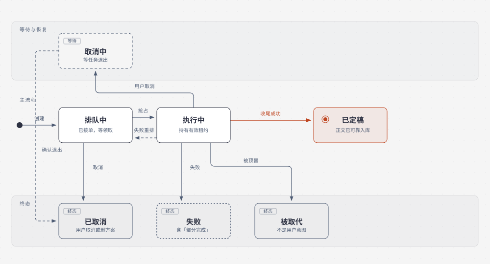
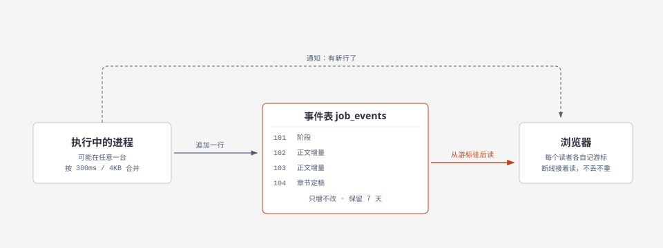

# 状态这件事：后端流转为什么重做、重做成什么样

> 本文是一次重构的设计说明。它回答一个问题：**「一个生成任务跑到哪了、成还是败、正文到底存没存」这件小事，为什么现在会出错，以及新架构凭什么不再出错。**
>
> 范围与边界写在最后一节。本文不是现状架构文档，现状以 [`ARCHITECTURE.md`](./ARCHITECTURE.md) 为准。

---

## 一、先说人话：我们在改什么

用户在页面上点「生成」，到拿到文档，中间有一条很长的路：任务要排队、要有人领、要跑几十秒到十几分钟、可能中途失败、可能被用户取消、可能被新的任务顶替。

这条路上有件事必须时刻说得清：**现在算什么？**

- 排队了没有？
- 谁在跑？跑在哪台机器上？
- 跑到哪一步了（大纲？正文？审核？）？
- 成功、失败、被取消，还是被取代？
- 最关键的一条：**正文到底存进数据库了没有？**

这套「状态」现在记在**三个地方**：进程内存里的一份运行时、任务表里的一行、文档版本表里的一版。三份各自有用，但它们之间靠什么保持一致？靠**人写的注释和约定**。

约定这种东西，写对一百次不出事，写漏一次就出事——而且是那种不报错、只是数据悄悄不对的出事。

---

## 二、现在到底出了什么毛病

不是三个孤立的 bug，是同一个根因的三种长相。

**毛病一：同一个任务会被收尾两次。**
排队排空或超时取消时，系统替任务收了一次尾（改终态、记账、通知前端）。过了一会儿，那个还卡在模型调用里的协程醒过来，按自己的逻辑又收了一次。结果是同一笔账记两遍、同一个「结束了」发两遍。

**毛病二：审核失败的时间戳，记到了别的版本上。**
重新审核时，如果用户在审核期间改过正文，结论会正确地不写入（不能给没审过的正文发判定）。但「这次审核没跑成」这个时间戳，却按「当前版本」写进去了——而当前版本已经是一份**没有被审过**的新正文。

**毛病三：任务报「完成」，正文其实没进库。**
收尾时先写任务终态（一个事务），再写正文（另一个事务）。第二个事务抛异常，代码只记了一条警告日志就继续往下走。于是任务表说「已定稿」，文档表里却没有这一版正文。用户刷新看到的是上一次的旧稿。

**三种毛病，一个根因：**

| 根因 | 说人话 |
|---|---|
| 没有唯一裁判 | 三份状态都能算数，出分歧时不知道该听谁的 |
| 没有唯一的改状态入口 | 「改状态」这件事散在六处代码里，每处各自实现一遍规则 |
| 终态和副作用不在一个事务 | 「宣布成功」和「把成果存好」是两件事，中间能断 |

---

## 三、新架构：四根柱子

这四根柱子是整篇设计的地基，后面所有细节都由它们推出来。

| 柱子 | 一句话 | 它消掉哪个毛病 |
|---|---|---|
| **数据库是唯一裁判** | 进程内存里的「我以为」一律不算数；任何争议以数据库那一行为准 | 三份状态各说各话 |
| **显式状态机** | 改状态只有一条路径，每次改之前必须证明「现在允许我改」 | 收尾两次（重复写入会被条件挡住） |
| **终态与落稿同事务** | 「宣布成功」和「正文入库」要么一起成，要么一起不成 | 报成功但没写库 |
| **统一版本锁** | 所有正文写入都带「我以为当前是第几版」，对不上就拒绝 | 手改与生成互相覆盖、结论贴错版本 |

> 这四个选择都有一个共同的代价：**代码里处处要带条件**。不能再「图省事直接把状态赋个值」。换来的好处是任何争议都有唯一裁决点。

---

## 四、任务的一生：七个状态

先把状态本身说清楚。七个状态，一句话各自：

| 状态 | 说人话 | 还能不能变 |
|---|---|---|
| **排队中** | 已接单，还没人领 | 可被领走，也可被直接取消 |
| **执行中** | 某个进程正拿着有效租约在跑 | 由它自己收尾，或由恢复器接手 |
| **取消中** | 用户已经说要停，等执行的人确认退出 | 由执行者或恢复器收口 |
| **已定稿** | 正文已经可靠存进库 | 终态，没有出口 |
| **失败** | 没跑成（含「跑了一半、内容是部分完成」） | 终态 |
| **被取代** | 同一份文档有更新的任务接手，这个让位 | 终态，**且不是用户意图** |
| **已取消** | 用户取消，或方案被删 | 终态 |

「被取代」和「已取消」为什么必须分开？因为它们长得一样（都是没结果），含义却相反：前者是系统的正常调度，后者是用户的明确意图。合并成一个，排查时永远分不清「是用户不要了，还是被新任务挤掉了」。



*图 1 · 一个任务的七个状态：主流程一条路，等待带一条，终态带三条*

### 图上没画出来的边缘分支

主图只画了「正常会走的路」。下面这些分支塞进图里会把线画成一团，所以单独列出来：

| 分支 | 从哪里到哪 | 条件 |
|---|---|---|
| **租约过期恢复** | 执行中 → 排队中 / 失败 | 执行者的进程崩了，租约到期；恢复器用扫描时读到的旧凭证接手，按剩余次数决定重排还是判死 |
| **取消超时兜底** | 取消中 → 已取消 | 执行者卡在模型调用里不肯退出，租约到期，恢复器替它落终态 |
| **取消时还没人领** | 排队中 → 已取消 | 直接落，不用等谁确认（没人在跑） |
| **方案被删** | 任意非终态 → 已取消 | 方案不存在了，什么都别写 |
| **被顶替** | 排队中 / 执行中 / 取消中 → 被取代 | 同一份文档来了更新的同类任务 |
| **可重试失败** | 执行中 → 排队中 | 错误属于「这一次通信没成」（限流、上游抖动、超时），且次数没用完 |

**每条转换在数据库里都是一条带条件的更新**，不是「读出来、判断、再写回去」。这是下一节要说的事。

### 入口处再挡一道：重复提交

还有一件不在这张图上、但同样属于「状态」的事：**同一份输入被提交了两次**（用户双击、网关重试）不该产生两条任务、调两次模型。

拦住它靠的是**已有的输入指纹**，不需要客户端额外交任何东西：同 owner + 同方案 + 同产物 + 同指纹，且 10 秒内已有任务 → 不新建，直接把那一条返回。

这条只挡窄窄的一类：它在时间窗内、指纹完全相同。**它不承诺跨设备或跨时间的幂等**——用户真想再来一次，过了时间窗就是一条新任务；而真正的「我就是要重跑」本来就该被允许。

---

## 五、凭什么它不会再「报成功但正文没写」

关键就在「收尾」这一步。一次成功的收尾要做五件事，新架构要求它们**在同一个事务里**完成：


*图 2 · 五件事在一个事务里：中间断掉，整批都不算数*

这张图要点在三处：

1. **第一步是条件更新，判据是「改到了几行」。** 改到 1 行，说明状态确实还是「执行中」、凭证确实是这一轮的、时间也确实没到期——三个条件同时成立。改到 0 行，说明你已经没资格写了，那就什么都不做，连账本都不记。
2. **第三步是版本锁。** 它回答「我以为的当前版本，还是不是真的当前版本」。对不上就整批失败，而不是静默覆盖用户刚改过的正文。
3. **失败的结果是可解释的。** 整批回滚之后任务还是「执行中」，租约到期后由恢复器接手——状态不会卡在某个说不清的地方。

---

## 六、多个进程同时跑，凭什么不打架

以前系统只能跑一个进程，因为「任务跑到哪了」在内存里，多开一个进程，两份内存各说各话。

状态搬进数据库之后，这件事就可以放开了。但放开就带来四个必须回答的问题：

**问题一：两个进程同时看到一个排队中的任务，谁领？**
不靠「先查出来再改」，因为查和改之间有一个窗口，两边都会以为自己可以。靠的是**把判断和修改压进同一条 SQL**：

```sql
UPDATE generation_jobs
   SET state='running', lease_owner=:谁, lease_token=:本轮凭证,
       lease_expire_at=:到期时间, attempt_count=attempt_count+1
 WHERE state='pending' AND id IN (…取一批待领的任务…);
```

数据库在改之前会重新判断一次条件。第一个进程改到的那些行变成「执行中」，第二个进程再执行同一条语句时，这些行已经不满足条件，它一行都改不到。**谁改到了行，谁才算领到。** 这不是靠错开时间去避让，而是靠数据库的原子性。

**问题二：领走的人崩了，谁接手？**
执行权不是「进程说自己在跑」，而是**数据库里一条会到期的租约**：谁领的、哪一轮的凭证、到几点失效。

进程崩了，租约还在倒计时；到期之后，恢复器扫到这一行，用**扫描时读到的旧凭证**做条件更新去接手。凭什么恢复器比正在跑的进程更有权？因为它也守同一条规则：凭证对不上，它一样一行都改不到。

**问题三：被交接之后，原来那个人算完了才回来，结果能写进去吗？**
写不进去。所有回写都要同时满足三个条件：

| 条件 | 挡住什么 |
|---|---|
| 状态还是「执行中」 | 已经被取消、或被恢复器接手的行，不该再被写 |
| 凭证还是本轮那个 | 换了执行者就换了凭证，旧凭证在数据库层面失效 |
| 到期时间还没过 | 进程没崩但卡了很久，租约已过期，也不该再写 |

三条合起来只回答一个问题：**我现在还有没有资格写这一行。** 三个都对不上，改到 0 行——结果直接丢弃、记一条「晚到结果已丢弃」的日志、**并且不许把它当成新的失败去重试**（否则一个已经失去资格的执行者会凭空制造新的尝试和额度消耗）。

**一个容易被忽略的细节：租约要续。**
以前的理由是一个任务就是一次模型调用，一两分钟；现在一篇文档要分批续写，可能跑十几分钟。所以新设计在**每个动作点**（每次模型调用前）续一次租约，把到期时间往后推。反过来，**续租失败本身就是信号**：说明你已经被取消或被接手了，该停下来——不需要另外轮询。

**问题四：失败了要不要立刻再试？**
不立刻。可重试失败会回排队，但先等一段时间再排：限流退 30 秒、上游 5xx 退 10 秒、超时退 5 秒。做法只是一列 `next_run_at`，抢占条件多一条 `AND next_run_at <= now`。

为什么值得多这一列：一次生成可能值十几分钟，而连续限流能把三次机会在几十秒内烧光——**不等，等于把「暂时忙」误判成「彻底失败」**。

有一个副作用必须写清：现在「回排队就更新 `updated_at`」是用来让任务排到同优先级队尾的。加了退避之后两套排序语义会叠加，规则固定为——**先看 `next_run_at` 到没到期，到期之后才按 `updated_at` 排队**。

> 落地（#88）：错误码 → 秒数的唯一映射表在 `services/job_backoff.py`；退避与清租约、`updated_at`、账本同批写入（`job_state.transition` 的 `REQUEUE` 分支）；**到期闸门**与**排队顺序**各只有一处定义（`repositories/generation_job_repo.py` 的 `_due_now` / `_queue_order`）。调度循环（谁来扫、多久扫一次）仍不在本期，见 #89。

---

## 七、用户是怎么看到进度的

这一节回答一个具体问题：流式输出要能工作，前提是「正在跑的那个进程，把中间产物写到任何进程都能读到的地方」。

以前这件事靠进程内的一个事件总线：谁在跑，谁就把增量直接推给连着它的浏览器。状态进数据库之后，这条路要换。



*图 3 · 过程写进表，读者按游标取；通知只负责叫醒人*

四个要点：

1. **追加，而不是覆盖。** 每次合并后追加一行，永不改写。覆盖式写法要反复重写整列（一份 60KB 的文档会被整列重写几十遍），而且回答不了「我错过的那一段是什么」。
2. **游标就是那一行的编号。** 读者说「我读到第 102 条了」，服务端从 103 给起。断线期间的还在表里，接上就继续；刷新就是重新拿一个游标；多台设备各读各的，不打架。
3. **通知只叫醒人，不送数据。** 数据库的「有新行了」通知是有上限、会丢的，所以它只当加速器；真正的数据永远从表里按游标读，没收到通知就靠定时轮询兜底。
4. **快照防止从头回放。** 新读者不可能回放两千条事件。所以每章定稿时更新一份快照，新读者先拿快照，再从快照那一刻的游标往后追。

---

## 八、三份产物为什么变同构

这一节是本次改动**最大**的一处——不是技术重构，是产品形态的取舍。

### 改成什么样

以前三份产物的生成方式不一样：接口文档和提示词是整篇一次写出来，PRD 是**分章并行**写（多章同时长、每章单独审、单独改）。

新设计把 PRD 也改成整篇，并且给三份都加了大纲：

| 阶段 | 三份产物现在都这么做 |
|---|---|
| 澄清 | 按产物各一条线程，需要时先对话 |
| **大纲** | 从上游材料里**抽取**结构（只抽取、不发明；抽不出的写「待确认」） |
| 撰写 | **分批续写**：撞上模型输出上限就接着写，不在中途判失败 |
| 审核 | 整篇审一次 |
| 改写 | 只有高严重度问题才触发，改一次，改完不重审 |

### 得到什么

- 三份走同一条管线，一套事件、一套审核、一套改写、一套修复、一套状态机。
- 前端不再有「PRD 看板」和「普通进度」两种展示。
- 长度不再是硬边界：分批续写让长文档能写完，而不是一次撞上限就白跑。

### 失去什么（这一条必须说清）

1. **多章同时长的观感没了**——改成一条连续的长流。
2. **单章失败的宽容度没了**——以前一章崩了用占位顶上，任务仍算完成；现在一处崩就是整篇崩。
3. **逐章重试和逐章审核没了**——只剩整篇级别的重试与审核。
4. **要退役一大片代码**：分章管线约 1900 行、章节级事件、前端多章看板、5 个 PRD 专用配置，以及约 90 个断言分章行为的用例。

换来的是「一套规则、一个状态机、一条管线」。

### 「部分完成」怎么办

整篇化之后，「写到一半就失败」这件事仍然会发生。新规则是：**已生成的内容不丢**。

- 把已经写出来的正文落成一个**新版本**，在版本上标「部分完成」；
- 这一版的审核区显示「未审核」，**并且不显示旧结论**（那份旧结论属于别的正文，摆在这里会被读成本次结果）；
- 用户可以下载它、拿去修复、或者干脆重生成。

这条改动让「失败」不再等于「什么都没留下」，也让「已定稿」不再等于「一定完整」——两者由版本上的标记区分。

---

## 九、这次改动的代价

写设计不写代价，等于只卖一半。以下是明确的账：

| 代价 | 说明 |
|---|---|
| 每次写入都要带条件 | 不能图省事直接赋值；任何一行写错，症状都是「不报错、只是数据不对」 |
| 进度要落库 | 每个任务大约每秒 3 次写入（合并窗口压住了），换来的是任何进程都能读 |
| 多进程更难排查 | 出问题要先问「任务跑在哪个进程、租约归谁」 |
| 失去并行分章的观感 | 见上一节 |
| 失败不再等于「没留下东西」 | 语义变复杂了：失败也可能有一版可用正文 |
| 一次性切换，不能靠并行运行退回 | 旧库直接拒绝启动；退回只能靠备份 + 旧镜像人工回滚，不是一键切换 |
| 大量代码与用例退役 | 约 1900 行 + 约 90 个用例，重写成本是实打实的 |

另外顺手补了一小块**运维可见性**：管理端的统计接口加四个数字——排队数、成功率、平均耗时、卡死数。不做完整看板，但至少要能回答「现在是不是在恶化」；没有这四个数，出了事只能翻表猜。

---

## 十、本期做、本期不做

### 本期做（排在核心改造之后）

这四项在最初版本里被排除过，复核后认为**成本很低、收益明确**，因此收进本期。顺序上排在核心改造（原子收尾、统一版本锁、事件表、抢占与恢复）之后，避免一次性大迁移里同时加功能。

| 做 | 怎么做 | 成本 |
|---|---|---|
| **创建请求去重** | 用已有的输入指纹：同 owner + 同方案 + 同产物 + 同指纹，10 秒内复用已有任务，不新建 | 一个唯一索引 + 一次查询 |
| **失败延迟退避** | 加一列 `next_run_at`，抢占条件加 `AND next_run_at <= now`；限流退 30 秒、上游 5xx 退 10 秒、超时退 5 秒 | 半票，注意与「回排队就更新 `updated_at`」的排序语义叠加 |
| **指标最小集** | 在现有管理端统计接口上加四个数：排队数、成功率、平均耗时、卡死数。**不做新看板** | 约一票 |
| **回滚预案** | 切换当天保留旧镜像与旧库文件副本；出事人工回滚。**不是并行运行** | 几乎为零 |

> 注：**全局限流**不单独立项——它与「退避」是同一件事的两面：撞了限流的任务自己退开 30 秒，等效于自适应限流，不需要独立的计数器。另配一条配置约定：每进程槽位 = 期望的全局并发 ÷ 进程数。

### 本期不做

每条都写清**结构性**理由，而不是「以后再说」：

| 不做 | 为什么不 | 不做的代价 |
|---|---|---|
| **引入分布式事务协调器**（2PC / Seata / XA） | 它解决的是「一次操作跨两个互不相干的资源」；这里只有一个 Postgres，**没有东西可协调**。而且跨机房恰恰最不该用两阶段提交——要跨广域网持锁，工业界做法是 Saga + 补偿 / 事务性发件箱 | 不引入：今天少一个常驻服务、少一类悬挂事务、少一处「反正有协调器兜底」的松懈。将来真要跨系统，补**事务性发件箱**即可（同事务写一条待发记录，后台补发），不需要协调器 |
| **Agent / RAG 多步编排** | 整套设计的前提是「一个任务 = 一次文档生成、一个结论」。多步编排意味着任务内部有子任务、有依赖、有等待，状态机要加一层，账本、取消、恢复全部重做——这是重开架构，不是加功能 | 一个任务仍然只对应一次文档生成 |
| **跨机分布式事务** | 单 Postgres 实例；跨机要两阶段提交或分布式协调器，代价与收益完全不成比例 | 数据库仍是单实例；将来要多机房，先按 `owner_id` 分片（这个分片键每张表都已经有），不够再谈 |
| **存量数据迁移** | 已确认当前没有真实用户数据；且仓库既有纪律是「SQLite 库不搬迁，结构不符即拒绝启动」 | 旧 SQLite 库不做搬运，检测到就拒绝启动 |
| **新旧版本并行运行** | 指**后端/数据库版本**并行，不是文档版本。并行要长期维护两套方言与两套后端，与「删掉 SQLite、Postgres 唯一」直接冲突 | 一次性切换；靠上面的「回滚预案」兜底，而不是靠并行跑 |

---

## 十一、实现落地差异（#75 收口时补记）

这篇文章写于动工之前，是**设计稿**。19 张票落地之后，有几处实现与它不完全一致——照实记在这里，不假装完全对齐。凡是「设计稿没写、实现里定了」的口径，以 [`ARCHITECTURE.md`](./ARCHITECTURE.md) 与 [`../agents/conventions.md`](../agents/conventions.md) 为准。

| 设计稿的说法 | 实际实现 | 差在哪 / 为什么 |
| --- | --- | --- |
| 「数据库的新行通知」只当加速器（图 3、§7 第 3 条） | **没有接数据库 `NOTIFY`**：唤醒只走进程内 `JobBus`（同样只叫醒、不送数据），之外靠 250ms 轮询兜底 | 单 worker 是部署硬约束（C-V9-2），进程内信号足够；`NOTIFY` 的收益要等多进程才出现。设计稿的**角色**没变（通知不承载数据），只是实现少了一层 |
| 列名叫 `state`（§6 的 SQL 示例） | 列名是 `generation_jobs.status` | 示例 SQL 是示意；真实列名以模型为准。看代码时别按示例去找 `state` |
| 「排队中」的表示（§4 的七个状态） | `pending` 是**唯一**表示；`running` 一定有租约。旧库里「`running` + 空租约」的行由迁移 `0007` 一次性映射成 `pending` | 施工中途曾同时存在两种同形表达（两个真源），#84 收口成一种。这条是**设计稿没写清、施工时补的** |
| 「每章定稿时更新一份快照」（§7 第 4 条） | 没有「章」了：快照按**既有合并写窗口**（≤300ms / 增量 >4KB）更新 `draft_content / phase / pending_items`，与事件行同笔事务提交 | 分章退役（#92）后「每章」这个时点不存在。快照的**作用**（新读者不回放历史）不变 |
| 「调度循环」排在 #89（§10、以及多张票的注释都这么写） | **已接上**（spec #75 双轴评审 P0-1）：`backend/src/backend/services/job_scheduler.py` 在 `lifespan` 末尾起三个 `asyncio` 周期任务——领取（约 1 秒，`claim_once` + 按库里的行重建任务单后派发）、收口（约 30 秒，`recover_once`）、清理（约 1 小时，`purge_expired_events`）；关闭阶段第一步 cancel + await，不留悬挂 task；开关 `job_scheduler_enabled`（测试默认关） | #89 当时只做成「管理端四个数字」，三个维护单元一直是「可直接调用的单元」而**没有生产调用者**——退避到期的行没人领、`cancelling` 超时没人兜底、过程日志永不清理，三条 AC 在运行期不可达。循环只补漏：新建任务仍是「登记 → 立刻抢占 → 起协程」 |
| 「分章管线约 1900 行、约 90 个断言」（§8「失去什么」） | 实测退役约 **8.2k 行**（含前端看板与用例） | 设计稿的数字是估的；实测口径在本轮各票的复测节里（见 [`roadmap.md`](./roadmap.md) §10.4） |
| 审核结论里没有提「失败章节清单」 | 分章时代结论里有一个 `failed_sections`（恒为空），#94 才删掉 | 施工期为了让前后端形状不变留了一格，收口票清掉。这也是「设计稿不写死字段、由实现补」的正常代价 |
| 「改写」在 §8 表里写「改一次」 | 实现里改写可能只重写**受影响的几节**、拼回整篇后整段覆盖（`part{replace}` 带完整正文），定位不到时退回整篇重写 | 用户看到的是「一次改写」，分节只是省 token 的内部优化；它不是第二条语义，也不是分章复活。**分节改写保留**：它按缺陷的 `where` 精确定位到小节再改，与「分章生成」（已退役）是两件事——分章是**生成单元**，分节是**一次整篇审核之后的落笔范围** |
| 设计稿的「重试次数」「快照游标」「进度快照」按列存（§7 / §8） | **没有加这四列**（`attempt_count` / `max_attempts` / `snapshot_cursor` / `progress_snapshot`）：重试次数用**账本行数**（`job_attempts` 的行数 = 已结束的执行次数）、快照游标用 `MAX(job_events.id)`、进度快照就是既有的 `draft_content` / `phase` / `pending_items` 三列 | 等价替代比新增四列便宜：每一列都要有一个写入点、一条迁移和一套「两处不一致时谁对」的规则，而这三件事各自都已经有一个权威来源。`attempt_no` 的分配也是 `MAX(attempt_no)+1`，与账本「行数即次数」同源 |
| 设计稿把「删方案 / 删账号」写成一次批量请求取消（§5） | 实现是**单步收口**：任意非终态 → `cancelled` + 清租约（`request_cancel_solution` / `request_cancel_owner` 用一条 `UPDATE … RETURNING`，账本逐条记一行） | 方案或账号已经不存在，不会再有「执行者来确认退出」这件事；留 `cancelling` 只是把行交给恢复器、等租约到期。代价是那一轮已烧掉的用量不再由确认方补记。同时**顶替不再覆盖 `cancelling`**：用户已表达停止意图，不能被改写成「被取代」 |

设计稿里**没有承诺过、也确实没做**的东西（别照着它去找）：审核结论的历史版本浏览、按正文变化自动判定结论过期、跨进程调度循环、`NOTIFICATION` 落库、续写用于审核 / 改写 / 修复。

---

## 附：一页速览

- **一个裁判**：数据库。进程内存只是缓存。
- **七个状态**：排队中、执行中、取消中、已定稿、失败、被取代、已取消。
- **一条路径**：改状态只有一条入口，每次都带条件，看影响行数。
- **一个事务**：宣布成功、记一条账、写正文、写结论、清租约，一起成或一起不成。
- **一把锁**：所有正文写入都带版本号，对不上就拒绝。
- **一条日志**：过程追加进事件表，读者按游标取，通知只负责叫醒。
- **一条管线**：三份产物都走「大纲 → 分批续写 → 整篇审核 → 整篇改写」。
