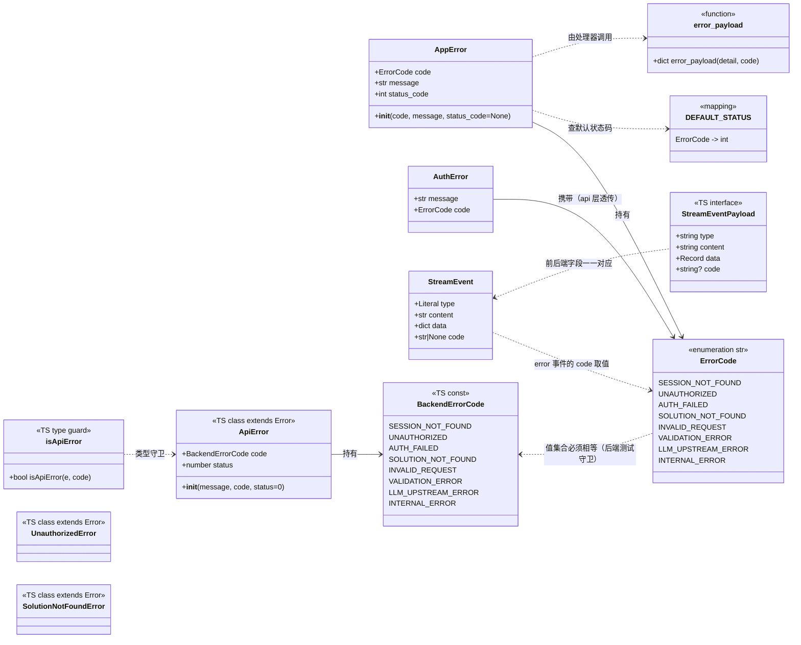
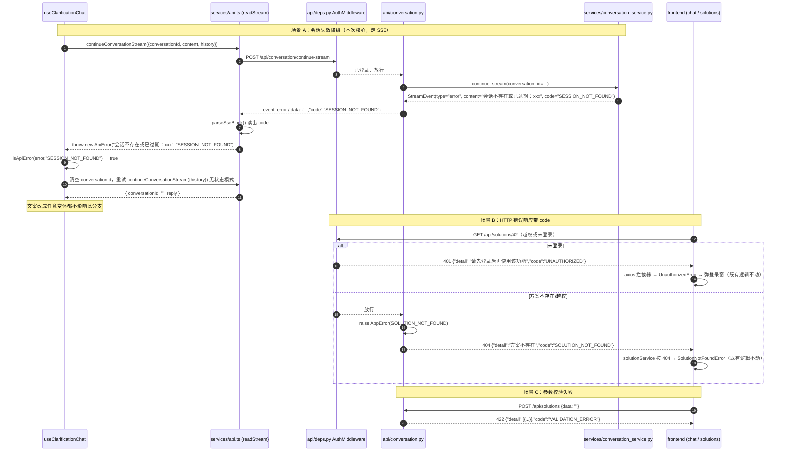
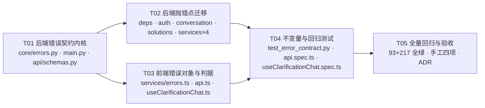
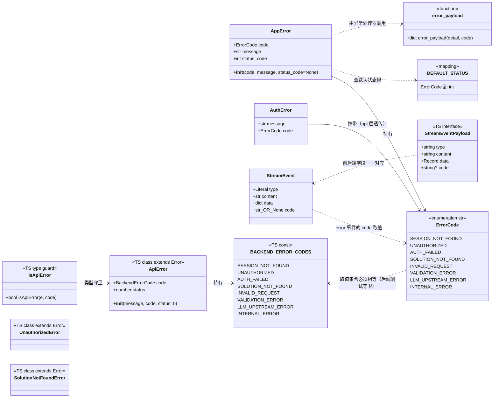
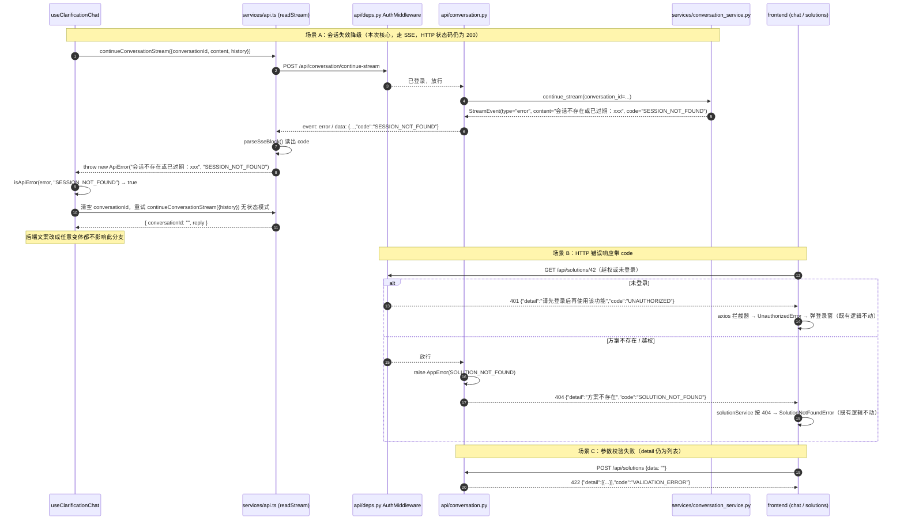

# v2 架构文档（2026-10-12 ~ 2026-10-14）

> 本文按 git 提交反推 v2 期**当时的架构设计**：v1 已经证明主链路跑得通，
> v2 要做的是把它变成**能长期使用、多人可用、出错可诊断**的产品。
> 收尾于 tag `v2.0.0`（`b78de90`）。时间线与方法见 `../README.md`。
>
> 本文只回答「**v2 是什么**」；「**为什么这么选**」见 `../../adr/README.md`（ADR-001 ~ 015，文中按主题标注了对应编号）。
> 施工期的一次性设计单据已逐字并入本文附录 A~D，不代表当前状态。

---

## 1. 目标

v1 验证了「需求 → 文档」这条链路，v2 围绕四条目标做产品化：

| # | 目标 | 要解决的问题 |
| --- | --- | --- |
| 1 | **生成质量** | 输出要贴模板、要能自审——靠技能包、分章节撰写审核改写、生成前的两道闸门 |
| 2 | **可留存** | 关掉浏览器不能丢——靠账号、方案快照持久化、owner 隔离 |
| 3 | **可维护** | 1305 行的单体不能再长——靠组件库、状态机外置、主题令牌、统一底栏 |
| 4 | **可守护** | 改坏了要有人拦——靠 CI、机器可读的错误契约、流式编排的单一实现 |

## 2. 范围

**本期做**：技能包驱动的 PRD 生成、分章节撰写 + 审核 + 改写、生成前双闸门（摘要确认 + 接口规范检索）、
三入口（完整流程 / 快捷入口 / 调试入口）、账号与默认拒绝鉴权、方案持久化与 owner 隔离、
前端解耦（组件库 / 状态机 / composables）、亮暗主题、底栏统一、CI、错误契约机器码化、流式编排收敛。

**本期不做（明确推迟到 v3，见 `../v3/`）**：长文生成的断点续传、多供应商 failover、
token 成本计量、技能资源热重载与启动校验、结构化日志与 `/health` 增强、容器化部署。

v2 的重心是**把产品做出来**；护栏是最后一天才补的，可靠性议题整体推迟到 v3——
这个顺序本身就是 v3 要把可靠性前置的理由。

## 3. 架构总览

```text
┌── 浏览器 ──────────────────────────────────────────────────────┐
│  AppV2.vue（只做分派）   router: /v2 · /v2/:id                  │
│  stores/  workflow（状态机 + 快照） solutions auth               │
│  composables/ useClarificationChat useDocumentPipeline useTheme │
│  components/ stages/(9)  form/  ui/(11 基础件)                  │
│  services/ api.ts（fetch 流式） errors.ts auth solutionService   │
└────────────────────────── /api ────────────────────────────────┘
                             │
┌── FastAPI ─────────────────┴────────────────────────────────────┐
│  中间件：AuthMiddleware（默认拒绝 + 白名单，纯 ASGI）→ CORS      │
│  api/       auth · conversation · config · solutions · deps      │
│  services/  conversation document prd_skill prd_section_writer   │
│             stream_reply stream_guard llm_factory ark_llm        │
│             auth_service solution_service llm_utils prompts      │
│  repositories/ auth_repo solution_repo（唯一写 SQL 的地方）      │
│  core/      config db errors question_config api_doc_knowledge   │
└─────────────────────────────────────────────────────────────────┘
  外部资产：skills/prd-generator/{skill.yaml, references/}
```

**依赖方向**：`api → services → repositories → db`，无反向 import；
SQL 只出现在 `repositories/`；`schemas.py` 集中契约。这条规则从 v1 延续并在 v2 被写死为 review 红线。

## 4. 后端设计

### 4.1 认证与接口可见性

- 凭据是**服务端不透明 token + HttpOnly Cookie**，不上 JWT：库里只存 token 的 SHA-256，
  密码用 `scrypt` + 独立 salt。
- 可见性靠**默认拒绝中间件**：白名单之外的接口自动受保护，新增接口无需逐个挂依赖。
  中间件写成纯 ASGI 类而不是 `BaseHTTPMiddleware`——后者会重新包装响应体，对 SSE 有风险。
- 注册开放但需邀请码；未登录不允许创建任务。

### 4.2 持久化

- SQLite 开 WAL + `busy_timeout`，四张表：`users` / `auth_sessions` / `invite_codes` / `solutions`。
- 方案采用**单表全量快照**：`solutions.data` 存整份 `SessionDataV2` 的 JSON 文本，
  **后端不解析其内容**；`title` / `mode` / `stage` 是冗余列，供列表页免反序列化展示。
- 所有查询强制带 `owner_id` 且不接受 `None`，越权一律返回 404（不泄露资源是否存在）。

### 4.3 生成链路

1. **`prd_skill`**：加载技能包（`skill.yaml` + `references/` 的模板、字段契约、写作规范），
   把结构化摘要或自由文本格式化成需求材料；资源缺失时降级到内置提示词。
2. **双闸门（生成前）**：
   - 闸门一 `sync-summary-from-conversation`：把对话结论回填成结构化摘要，前端做 Diff 确认后才回写；
   - 闸门二 `retrieve-api-docs-rag`：用本地词法检索（BM25 风格）从 `core/api_doc_knowledge.json`
     检索接口规范，用户勾选后作为生成依据。
   - 两者失败或返回非法 JSON 时，一律**返回原摘要的深拷贝**，绝不弄丢用户已填的需求。
3. **`prd_section_writer`**：按模板的 7 个一级章节串行生成，每章三步——
   **撰写 → 审核（返回 JSON 判定 pass/revise）→ 必要时改写**（改写轮数有上限）。
   后续章节带上「已定稿的前序章节」作为上下文，保证全文口径一致（如 6.1 引用 2.1 的功能编号）。
4. **`stream_reply`**：全项目唯一的流式编排出口（`astream_text` / `iter_reply_events` /
   `collect_reply` / `error_event`），`stream_guard` 只管截断检测。

### 4.4 错误契约

错误响应统一为 `{"detail": <中文原文>, "code": "<UPPER_SNAKE>"}`，8 个机器码集中在 `core/errors.py`；
**SSE 的 `error` 事件也带顶层 `code`**（v1 起错误就在流内表达，HTTP 状态码恒为 200）。
前端据此判断（`isApiError(error, 'SESSION_NOT_FOUND')`），不再匹配中文文案。

### 4.5 模型接入

延续 v1：三供应商抽象不变，`max_tokens` 分档，`ark` 走官方 SDK。v2 未引入 failover（推迟到 v3.0）。

## 5. 前端设计

| 关注点 | 设计 |
| --- | --- |
| 外壳 | `AppV2.vue` 只做分派；`router.ts` 只有 `/v2` 与 `/v2/:id` 两条；**阶段流转走状态机，不进 URL** |
| 状态 | `stores/workflow.ts`（阶段机 + 快照）、`stores/solutions.ts`（列表 + 1.5s 防抖保存）、`stores/auth.ts` |
| 复用逻辑 | `composables/`：`useClarificationChat`（澄清对话）、`useDocumentPipeline`（文档流水线）、`useTheme`（主题） |
| 组件（ADR-015） | `stages/` 9 个阶段组件、`form/` 表单编辑器、`ui/` 11 个基础件（按钮 / 卡片 / 对话框 / 图标 / Toast…）；其中 `AppDialog` / `AppToast` / `AppEmpty` / `AppInput` **已建未接线**（`AuthDialog` 仍手写 Teleport，表单输入仍自绘） |
| 主题（ADR-014） | 三层语义令牌：`@theme` → `@theme inline` → `:root` / `.dark`；组件只用语义令牌，`dark:` 只留给结构性判断、状态色 tint、模态遮罩三类例外（残留 101 处 / 19 文件，是已知的未完成收敛） |
| 操作落点（ADR-015） | `ui/AppActionBar.vue` 是全站唯一操作栏：内容行（文档工具 / 输入框）+ 流程行（永远存在），主操作永远最右且唯一；`DocumentReview.vue` 只渲染卡片、自带零控件，能力经 `defineExpose` 交给底栏 |
| 流式读取 | 原生 `fetch` + `ReadableStream`（axios 不支持流式读）；**正文以 `part` 事件为准**——每章定稿整段下发，因此预览与最终 `done.reply` 逐字同源 |
| 契约 | `types/index.ts` 是准绳，后端迁就前端字段名 |
| 错误 | `services/errors.ts` 独立成文件（`ApiError` / `isApiError`），避免被测试里的模块级 mock 替换 |

> **现状（v8 之后）**：上表「`ui/` 11 个基础件」是 v2 时的口径——`AppToast` / `AppEmpty` / `AppInput` 已于 #2 删除，`AppDialog` 实际仍被审阅页引用；三个孤儿资源、两个零引用函数与一个死类型也已清理。逐项见 `docs/architecture/v8/CLEANUP.md` 的 A3~A5 / A10。

**保存策略**：严格「有内容了才建」——无 id 时 `POST` 后 `router.replace('/v2/{id}')`，有 id 时 `PUT` 整份覆盖；
`generating-*` 阶段不触发保存（避免把半截文档写进去）。

## 6. 关键契约

- **SSE 事件**：`status` / `chunk` / `part` / `stage` / `done` / `error`，`error` 带 `code`。
  `part` 的 `data.text` 是**可直接追加到文档末尾的权威文本**（含补写的标题行与章间空行）；
  `stage` 报告「写到第几章、在写还是在审」。
- **错误响应**：`{detail, code}`；`detail` 的措辞与结构不变，只是并列多出一个 `code`。
- **方案保存**：`{title, mode, stage, data}`，`data` 对后端不透明。
- **认证**：Cookie `prdwright_session`（HttpOnly）。

## 7. 设计取舍

| 取舍 | 理由 |
| --- | --- |
| 单表全量快照而非拆表 | 方案内容会持续变形，差集同步的复杂度远超整份覆盖；后端当不透明字符串存取 |
| 默认拒绝 + 白名单，而非逐接口挂依赖 | 新增接口天然受保护，漏挂依赖不再是安全隐患 |
| 纯 ASGI 中间件 | `BaseHTTPMiddleware` 会重包响应体，对 SSE 有风险 |
| 分章节串行 + 前序上下文 | 章节间有跨引用（6.1 引 2.1 编号、附录汇总全部待确认），并行会破坏一致性 |
| 定稿后整段下发 `part` | 让后端成为正文的唯一来源，前端不必复现补标题/补空行的加工 |
| 主题只用语义令牌（ADR-014） | 组件里写 `dark:` 分支会随组件数量爆炸，令牌层一处切换即可 |
| 底栏为唯一操作落点（ADR-015） | 操作分散在各处时，用户找不到「下一步该点哪」 |
| 错误带机器码 | 前端匹配中文文案是活 bug，文案一改判断就失效 |

## 8. 收尾状态

v2 共 25 个提交，120 files，+22776 / −2099（约为 v1 全部代码的 4 倍，是一次重写而非增补）。
收尾提交 `b78de90`，标注为 tag `v2.0.0`；护栏状态：CI 双 job 已跑绿，后端 117 例 / 前端 222 例，全程离线零 token。

---

## 附录 A：R0-T5 错误契约机器码化 · 增量设计与任务分解

> 迁自 `archive/system_design.md`（原文件已删除，内容逐字保留）。

> **归档留档（已完工，不代表当前状态）**
> 本文是 2026-10-14 施工时的增量设计与任务分解，是一次性施工单据，不是常青文档。
> 结论已压缩为 [`../../adr/ADR-012-错误契约用-机器码-人类消息-code-是唯一判据.md` 的 ADR-012](../../adr/ADR-012-错误契约用-机器码-人类消息-code-是唯一判据.md)；**当前实现以 `ARCHITECTURE.md` 为准**。
> 保留它是为了回溯「当时为什么这么拆任务」，不用于了解现状。
>
> 适用范围：既有项目上的**增量改造**（不是从零开始）。品牌 PRDwright，根目录仍为 `HarnessPRD`。
> 目标：把「错误判据靠中文串匹配」这个活 bug，换成机器可读的 `code`，并配不变量测试防回退。

---

## 0. 现状复核结论（实地读码，含对任务书的更正）

| # | 结论 | 证据 |
|---|---|---|
| 1 | 前端唯一硬判据确实是中文串匹配 | `frontend/src/composables/useClarificationChat.ts:128`<br>`if (!conversationId.value \|\| !message.includes('会话不存在')) throw error` |
| 2 | **更正**：该串不是来自 `HTTPException`，而是来自 **SSE 流式 `error` 事件** | 后端 `services/conversation_service.py:487-491` 产出 `StreamEvent(type="error", content=f"会话不存在或已过期：{conversation_id}")`；<br>前端 `services/api.ts:329-331` 收到 `error` 事件后 `failure = event.content`，`readStream` 末尾 `throw new Error(failure)`（HTTP 状态码是 **200**）<br>⇒ 只给 HTTP 响应加 `code` **解决不了这条链路**，必须同时给 SSE `error` 事件加 `code` |
| 3 | 后端确无任何机器可读错误码 | 全仓库 grep `error_code` / `ErrorCode` 零命中 |
| 4 | 后端确无异常处理器 | `main.py` 无 `@app.exception_handler`，当前错误响应来自 FastAPI 默认处理器 + 中间件裸写 JSON |
| 5 | 错误响应有 **4 个来源**，改造必须全覆盖 | ① `HTTPException`（默认处理器 → `{"detail": ...}`）<br>② `RequestValidationError`（422 → `{"detail": [...]}`，**detail 是列表**）<br>③ `AuthMiddleware._send_unauthorized`（`deps.py:113` 裸写 ASGI JSON）<br>④ SSE `error` 事件（流内，非 HTTP 错误） |
| 6 | 已做对、本次不动 | 401 → `UnauthorizedError`（`api.ts`，基于状态码）<br>404 → `SolutionNotFoundError`（`solutionService.ts`，基于状态码） |
| 7 | 已有可复用的「扫前端源码」不变量测试范式 | `backend/tests/test_conversation_prompt.py::test_frontend_holds_no_prompt_text`（扫 `frontend/src`，跳过 `__tests__`） |
| 8 | services 层已经 import `api.schemas` | `conversation_service.py:24`、`document_service.py:48` 都 `from backend.api.schemas import StreamEvent`<br>⇒ 在 `api/schemas.py` 的 `StreamEvent` 上加 `code` 字段不违反现有依赖方向；但**错误码枚举必须放 `core/`**，否则 services 反向依赖 api 之外的东西会变差 |
| 9 | `instanceof` 有个真实陷阱 | `frontend/src/__tests__/AppV2.spec.ts:19` 用 `vi.mock('../services/api', () => ({...}))` **整体替换** api 模块。若 `ApiError` 定义在 `api.ts` 里，mock 后 `instanceof ApiError` 会抛 `TypeError`。<br>⇒ `ApiError` 必须放在**独立模块**，不被 mock 波 |

---

## Part A · 增量设计

### 1. 实施思路（Implementation Approach）

**核心难点**：一处耦合在 **SSE 流内**（HTTP 200），其余耦合在 **HTTP 错误响应**里；而 `detail` 字段的语义必须保持不变（现有 93 个后端测试 + 前端 `readDetail()` / `backendMessage()` 都依赖它）。

**因此策略是「加字段 + 加异常处理器」，不是「换响应结构」：**

1. **响应体**：`{"detail": "<人类可读中文，语义不变>", "code": "<机器码>"}`。
   `HTTPException(detail={"detail":..., "code":...})` 会被 FastAPI 渲染成 `{"detail": {"detail":..., "code":...}}` 的**嵌套结构**，所以不能靠塞 dict 解决——必须注册**自定义异常处理器**，这是唯一能「一处保证所有错误响应都带 code」的做法。
2. **SSE**：给 `StreamEvent` 加一个可选 `code` 字段，`error` 事件带上它；前端 `readStream` 抛出携带 `code` 的 `ApiError`。
3. **防漂移**：后端 `core/errors.py` 是单一真源；前端 `services/errors.ts` 是单一真源；由**后端测试扫描前端源码**断言两个集合相等（复用第 7 条既有范式）。
4. **防回退**：① 后端测试断言每个 4xx/5xx 响应体含合法 `code`；② 后端测试扫描 `api/*.py` 断言 `HTTPException` 归零；③ 后端测试扫描前端源码断言不再有中文串判据。

**架构模式**：沿用现有分层——`api/` 解析/校验/封装，`services/` 业务，`core/` 跨层契约与基础设施。不引入新框架，不新增第三方依赖。

### 2. 文件清单（File List）

| 文件 | 动作 | 说明 |
|---|---|---|
| `backend/src/backend/core/errors.py` | **新建** | `ErrorCode` 枚举、`AppError` 异常、状态码默认映射、响应体构造函数 |
| `backend/src/backend/main.py` | 改 | 注册 `AppError` 与 `RequestValidationError` 两个异常处理器 |
| `backend/src/backend/api/schemas.py` | 改 | `StreamEvent` 增加 `code` 字段 |
| `backend/src/backend/api/deps.py` | 改 | `_send_unauthorized` 裸写 JSON 加 `code`；`get_current_user` / `acting_user` 改抛 `AppError` |
| `backend/src/backend/api/auth.py` | 改 | register / login / me 三处改抛 `AppError` |
| `backend/src/backend/api/conversation.py` | 改 | 4 处 `HTTPException` → `AppError`；SSE 兜底 `error` 事件带 `code` |
| `backend/src/backend/api/solutions.py` | 改 | 3 处 404 → `AppError(SOLUTION_NOT_FOUND)` |
| `backend/src/backend/services/auth_service.py` | 改（小） | `AuthError` 增加 `code` 字段，供 api 层直接透传（避免 api 层再维护映射表） |
| `backend/src/backend/services/conversation_service.py` | 改 | 「会话不存在」与「生成失败」两类 `error` 事件带 `code` |
| `backend/src/backend/services/document_service.py` | 改 | 「生成失败」`error` 事件带 `code` |
| `backend/src/backend/services/prd_section_writer.py` | 改 | `error` 事件带 `code` |
| `backend/tests/test_error_contract.py` | **新建** | 不变量 + 契约测试（含扫前端源码） |
| `frontend/src/services/errors.ts` | **新建** | `BackendErrorCode` 常量与类型、`ApiError` 类、`isApiError` 类型守卫 |
| `frontend/src/services/api.ts` | 改 | `readStream` 解析 SSE `error` 事件的 `code`，抛 `ApiError` |
| `frontend/src/composables/useClarificationChat.ts` | 改 | 判据由 `message.includes('会话不存在')` 换成 `isApiError(error, 'SESSION_NOT_FOUND')` |
| `frontend/src/__tests__/api.spec.ts` | 改 | 追加 SSE error → `ApiError.code` 的用例 |
| `frontend/src/__tests__/useClarificationChat.spec.ts` | **新建** | 降级重试用例（直接用**任意文案**构造错误，证明与文案解耦） |
| `docs/adr/` | 改（T05 收尾） | 记一条 ADR：错误契约以 `code` 为唯一判据 |

### 3. 数据结构与接口（Data Structures and Interfaces）



### 4. 错误码清单（8 个，含触发场景）

| # | code | 载体 | HTTP/SSE | 触发场景 | 现有来源（文件:行） | 谁消费 |
|---|---|---|---|---|---|---|
| 1 | `SESSION_NOT_FOUND` | **SSE `error` 事件** | SSE（HTTP 200 流内） | `continue-stream` 传入的 `conversation_id` 在服务内存里已不存在（服务重启 / 多实例） | `services/conversation_service.py:487` | ★ **前端 `useClarificationChat` 据此清 ID 并退无状态模式重试**——本次核心 |
| 2 | `UNAUTHORIZED` | HTTP | 401 | 未登录或会话过期（不区分两者） | `api/deps.py:113`（裸写）、`api/deps.py:143`、`api/deps.py:167`、`api/auth.py:99`（`/me`） | 前端 `UnauthorizedError`（已有，基于状态码；加码后双保险） |
| 3 | `AUTH_FAILED` | HTTP | 400（注册）/ 401（登录） | `AuthError` 全部业务分支：用户名长度越界、密码过短、未填邀请码、用户名已注册、邀请码无效或已用完、注册失败、用户名或密码错误、账号已停用 | `api/auth.py:53`、`api/auth.py:70` | 登录 / 注册表单（与 `UNAUTHORIZED` 区分：前者是「你填错了」，后者是「你没登录」） |
| 4 | `SOLUTION_NOT_FOUND` | HTTP | 404 | 方案不存在 **或** 存在但不属于当前用户（后端刻意不可区分） | `api/solutions.py:70 / 94 / 113` | 前端 `SolutionNotFoundError` |
| 5 | `INVALID_REQUEST` | HTTP | 400 | 业务入参不满足：`summary` 与 `requirements` 都为空 | `api/conversation.py:268` | 通用 |
| 6 | `VALIDATION_ERROR` | HTTP | 422 | Pydantic 请求体校验失败（`detail` **仍为列表**，语义不变） | FastAPI 自动 | 通用 |
| 7 | `LLM_UPSTREAM_ERROR` | HTTP / SSE | 502 / SSE `error` | 模型侧失败：需求摘要回填失败（502）、流式生成失败 | `api/conversation.py:135`、`services/conversation_service.py:393`、`services/document_service.py:657`、`services/prd_section_writer.py:776` | 前端未来可提示「模型侧异常，可重试」（本次只留码，不改 UI） |
| 8 | `INTERNAL_ERROR` | HTTP / SSE | 500 / SSE `error` | 服务端内部错误：问卷配置文件缺失、问卷配置非法 JSON、接口规范检索失败、SSE 生成器兜底捕获 | `api/conversation.py:89 / 97 / 164`、`api/conversation.py:72` | 通用兜底 |

> **为什么是 8 个**：按「现有所有抛错点归并」得出，不预留空码。新增码必须同时改后端枚举与前端常量（后端测试会自动校验两边集合相等）。
> **已知边界**：FastAPI 框架自身产生的 404（路由不存在）/ 405 不在此列（未注册兜底处理器），见 §待明确 Q2。

### 5. 响应体与 SSE 事件结构

**HTTP 错误响应**（`detail` 语义与取值完全不变，仅并列新增 `code`）：

```jsonc
// 4xx/5xx（除 422）
{ "detail": "会话不存在或已过期：conv-1", "code": "SESSION_NOT_FOUND" }
{ "detail": "方案不存在",                 "code": "SOLUTION_NOT_FOUND" }
{ "detail": "请先登录后再使用该功能",      "code": "UNAUTHORIZED" }

// 422（detail 保持 FastAPI 的列表结构，兼容前端已有的数组特判）
{ "detail": [{"loc": [...], "msg": "...", "type": "..."}], "code": "VALIDATION_ERROR" }
```

**SSE `error` 事件**（新增顶层 `code` 字段；`content` 仍是人类可读中文）：

```
event: error
data: {"type":"error","content":"会话不存在或已过期：conv-1","data":{"conversation_id":"conv-1"},"code":"SESSION_NOT_FOUND"}

```

### 6. 程序调用流（Program Call Flow）



### 7. Anything UNCLEAR（待明确事项）

见 Part B §待明确。

---

## Part B · 任务分解

### 8. Required Packages

**无新增第三方依赖。**

```
# 后端：全部使用现有依赖（fastapi / starlette / pydantic）
# 前端：全部使用现有依赖（vue / axios / vitest）
```

### 9. 任务列表（按依赖顺序，共 5 个）

#### T01 · 后端错误契约内核与全局处理器（P0，无依赖）

| 项 | 内容 |
|---|---|
| 文件 | `backend/src/backend/core/errors.py`（新建）、`backend/src/backend/main.py`（改）、`backend/src/backend/api/schemas.py`（改） |
| 改什么 | ① `core/errors.py`：`ErrorCode(str, Enum)` 8 个成员；`DEFAULT_STATUS: dict[ErrorCode, int]`（`SESSION_NOT_FOUND` 无 HTTP 语义可不入表或记 200；`UNAUTHORIZED`/`AUTH_FAILED`→401；`SOLUTION_NOT_FOUND`→404；`INVALID_REQUEST`→400；`VALIDATION_ERROR`→422；`LLM_UPSTREAM_ERROR`→502；`INTERNAL_ERROR`→500）；`class AppError(Exception)` 含 `code / message / status_code`，`status_code` 缺省时查 `DEFAULT_STATUS`；`error_payload(detail, code) -> dict` 返回 `{"detail": detail, "code": code}`<br>② `main.py`：注册 `@app.exception_handler(AppError)`（渲染 `{"detail": exc.message, "code": exc.code.value}`）与 `@app.exception_handler(RequestValidationError)`（渲染 `{"detail": exc.errors(), "code": "VALIDATION_ERROR"}`，status 422）；注册位置在路由注册之前<br>③ `api/schemas.py`：`StreamEvent` 增加 `code: str \| None = Field(default=None, description="机器可读错误码；仅 error 事件携带，取值见 core/errors.py 的 ErrorCode")` |
| 验收 | `uv run pytest` 全绿（此时尚未改调用点，不应有行为变化） |
| 依赖 | — |

#### T02 · 后端抛错点迁移（P0，依赖 T01）

| 项 | 内容 |
|---|---|
| 文件 | `api/deps.py`、`api/auth.py`、`api/conversation.py`、`api/solutions.py`、`services/auth_service.py`、`services/conversation_service.py`、`services/document_service.py`、`services/prd_section_writer.py` |
| 改什么 | ① `services/auth_service.py`：`AuthError` 增加 `code` 属性（注册类分支 `AuthError(msg, ErrorCode.AUTH_FAILED)`；登录类分支同为 `AUTH_FAILED`）<br>② `api/auth.py`：三处 `HTTPException` → `raise AppError(code=exc.code, message=exc.message)`（register/login）与 `AppError(UNAUTHORIZED, "当前未登录")`（/me）<br>③ `api/deps.py`：`_send_unauthorized` 的裸写 JSON 改为 `{"detail": _UNAUTHORIZED_DETAIL, "code": "UNAUTHORIZED"}`；`get_current_user` / `acting_user` 改抛 `AppError(UNAUTHORIZED, _UNAUTHORIZED_DETAIL)`<br>④ `api/solutions.py`：3 处 404 → `AppError(SOLUTION_NOT_FOUND, _NOT_FOUND_DETAIL)`<br>⑤ `api/conversation.py`：`.89/.97` → `INTERNAL_ERROR`；`.135` → `LLM_UPSTREAM_ERROR`；`.164` → `INTERNAL_ERROR`；`.268` → `INVALID_REQUEST`；`.72` SSE 兜底 `error` 事件加 `code="INTERNAL_ERROR"`<br>⑥ `services/conversation_service.py:487` 加 `code="SESSION_NOT_FOUND"`；`:393` 加 `code="LLM_UPSTREAM_ERROR"`<br>⑦ `services/document_service.py:657`、`services/prd_section_writer.py:776` 加 `code="LLM_UPSTREAM_ERROR"`<br>⑧ 全部改造完成后，`api/` 下 `HTTPException` 引用应归零（由 T04 的不变量测试断言） |
| 验收 | `uv run pytest` 全绿；既有断言 `response.json()["detail"] == "方案不存在"` / `"请先登录后再使用该功能"` 仍成立（`detail` 一字未改） |
| 依赖 | T01 |

#### T03 · 前端错误对象与判据改造（P0，依赖 T01 的码值定义；可与 T02 并行）

| 项 | 内容 |
|---|---|
| 文件 | `frontend/src/services/errors.ts`（新建）、`frontend/src/services/api.ts`（改）、`frontend/src/composables/useClarificationChat.ts`（改） |
| 改什么 | ① `services/errors.ts`：导出 `BACKEND_ERROR_CODES`（8 个 `as const`）、`BackendErrorCode` 类型、`class ApiError extends Error { code; status }`、`function isApiError(e: unknown, code: BackendErrorCode): boolean`。**必须独立文件**：`AppV2.spec.ts` 会 `vi.mock('@/services/api')` 整体替换模块，放里面会让 `instanceof` 失效<br>② `api.ts`：`StreamEventPayload` 增加 `code?: string \| null`；`parseSseBlock` 解析出 `code`；`readStream` 的 `error` 分支改为记 `{ message, code }`，末尾 `throw new ApiError(message, normalizeCode(code))`（`code` 缺失/未知时降级为 `INTERNAL_ERROR`）<br>③ `useClarificationChat.ts:128` 判据改为 `if (!conversationId.value \|\| !isApiError(error, 'SESSION_NOT_FOUND')) throw error`；同步把注释里「收到『会话不存在』时」改成「收到 `SESSION_NOT_FOUND` 时」 |
| 验收 | `npm run test:unit -- --run` 与 `npm run build` 全绿 |
| 依赖 | T01（码值需与后端一致） |

#### T04 · 不变量与回归测试（P0，依赖 T02 + T03）

| 项 | 内容 |
|---|---|
| 文件 | `backend/tests/test_error_contract.py`（新建）、`frontend/src/__tests__/api.spec.ts`（追加）、`frontend/src/__tests__/useClarificationChat.spec.ts`（新建） |
| 改什么 | **后端 `test_error_contract.py`**（复用 `test_conversation_prompt.py` 的「扫前端源码」范式，`_FRONTEND_SRC = parents[2]/"frontend"/"src"`，前端不存在时 `pytest.skip`）：<br>· `test_every_error_response_carries_code`：参数化覆盖 401（未登录业务接口 / `/me`）、400（注册失败）、401（登录失败）、404（方案不存在/越权）、400（summary 与 requirements 皆空）、422（空 data），断言 `status>=400`、`body["code"]` 存在且属于 `ErrorCode` 取值集合、`body["detail"]` 非空<br>· `test_frontend_error_codes_match_backend`：正则解析 `frontend/src/services/errors.ts` 中的码值集合，断言与 `{c.value for c in ErrorCode}` **相等**（防两边漂移）<br>· `test_frontend_makes_no_chinese_string_judgement`：扫描 `frontend/src` 下非 `__tests__` 的 `.ts/.vue`，禁止「对含中文的字符串字面量做包含/相等判断」（`includes(` / `indexOf(` / `startsWith(` / `endsWith(` / `match(` / `===` / `!==` 后接含中文的字符串字面量）。已核查：现有源码中除 `useClarificationChat.ts:128` 外**零误报**<br>· `test_api_layer_raises_no_bare_http_exception`：扫描 `backend/src/backend/api/*.py`，断言不再出现 `HTTPException`（防新代码回退）<br>**前端**：<br>· `api.spec.ts` 追加：SSE `error` 事件带 `code` → 抛出的 `ApiError.code` 正确；不带 `code` → 降级为 `INTERNAL_ERROR`；`code` 未知 → 降级为 `INTERNAL_ERROR`<br>· `useClarificationChat.spec.ts` 新建：mock `continueConversationStream` 首次以 `new ApiError('随便改成什么文案', 'SESSION_NOT_FOUND')` 拒绝 → 断言清空 `conversationId` 后以无状态模式重试一次；以 `LLM_UPSTREAM_ERROR` 拒绝 → 断言**不**重试并向上抛 |
| 验收 | 后端 93+ 例、前端 217+ 例全绿 |
| 依赖 | T02、T03 |

#### T05 · 全量回归与验收（P1，依赖 T04）

| 项 | 内容 |
|---|---|
| 文件 | `docs/adr/`（追加一条 ADR）；不改业务代码（手工验收的临时改动必须还原） |
| 改什么 | ① 全量跑：`cd backend && uv run pytest`；`cd frontend && npm run test:unit -- --run && npm run build`<br>② 手工验收四项：a) 前端源码 grep 不到 `includes('中文')` 这类判据；b) 任一 4xx/5xx 响应体含 `code`；c) 310 用例全绿；d) **临时**把后端「会话不存在或已过期」改成任意变体（如「该会话已失效：」），跑前端用例 + 手点一次续接对话，确认降级仍生效，**然后改回**<br>③ ADR 记录：错误契约以 `code` 为唯一机器判据，`detail` 仅供展示且可随时改写 |
| 验收 | 四项全过；`git status` 干净（除本次设计改动外无残留） |
| 依赖 | T04 |

### 10. Shared Knowledge（跨任务共享约定）

```
1. 响应体：{"detail": <原样不变>, "code": "<UPPER_SNAKE_CASE>"}。detail 是人类可读中文，可随时改写；
   code 是唯一机器判据。禁止用 detail 做分支判断。
2. 码值命名：UPPER_SNAKE_CASE、英文、名词或状态短语（SESSION_NOT_FOUND，不是 session-not-found / 404）。
3. 后端单一真源：backend/src/backend/core/errors.py :: ErrorCode。
   前端单一真源：frontend/src/services/errors.ts :: BACKEND_ERROR_CODES。
   两边相等由后端测试 test_frontend_error_codes_match_backend 守着——新增码只改一边会红。
4. 分层：core/ 放跨层契约（services 与 api 都能 import，不产生反向依赖）；
   api/ 只做解析/校验/封装；services/ 抛域错误（AuthError 带 code），由 api 层透传，不在 api 层写映射表。
5. SSE：error 事件的 code 走 StreamEvent 的顶层 code 字段，不塞进 data（data 保留给事件专属载荷）。
6. 前端禁止：error.message.includes('中文') / indexOf / startsWith / === 等一切基于文案的判定，
   统一用 isApiError(error, 'XXX')。
7. ApiError 必须定义在 frontend/src/services/errors.ts（独立模块），不得放进 services/api.ts——
   AppV2.spec.ts 会整体 mock '@services/api'，放里面会让 instanceof 抛 TypeError。
8. 既有结构化处理保持不动：401 → UnauthorizedError（api.ts）、404 → SolutionNotFoundError（solutionService.ts）。
9. 注释与 docstring 一律中文，标识符一律英文。
10. 不新增第三方依赖；不做无关重构。
```

### 11. 任务依赖图（Task Dependency Graph）



### 12. 待明确事项（需拍板）

| # | 问题 | 备选 | 我的建议 |
|---|---|---|---|
| Q1 | SSE `error` 事件的 `code` 放**顶层字段**还是 `data.code`？ | A. `StreamEvent` 新增 `code` 字段（会出现在 OpenAPI 里，自解释）；B. 放进现有 `data` 字典（不动模型，但 `data` 混杂语义） | **A**。改动仅一个字段，前端 `parseSseBlock` 多读一次；可发现性明显更好 |
| Q2 | 是否注册 `StarletteHTTPException` **兜底处理器**，让框架生成的 404（路由不存在）/ 405 也带 `code`？ | A. 不加（保持 8 码，最小变更）；B. 加，需再引入第 9 个通用码 `NOT_FOUND` | **A**。本次只保证「我们自己抛的错」带码；框架级 404 无业务语义。若坚持「任何 4xx 都有 code」则选 B |
| Q3 | 422 的 `detail` 仍是**列表**（`solutionService.ts` 已特判成「提交的内容不符合要求…」），要不要顺手统一成字符串？ | A. 不动；B. 改成字符串 | **A**。`detail` 语义不变是本次向后兼容的前提，动它会波及前端既有分支 |
| Q4 | `services/auth_service.py` 的 `AuthError` 是否需要带 `code`？ | A. 带（api 层直接透传）；B. 不带（api 层按端点写死 AUTH_FAILED） | **A**。避免 api 层再维护一张「文案→码」映射表，那正是本次要消灭的东西 |
| Q5 | 现有 `UnauthorizedError`（`api.ts`）要不要改成继承 `ApiError`？ | A. 不动；B. 继承并带上 `code='UNAUTHORIZED'` | **A**。它已基于 HTTP 401 工作正常，改它属于「顺手优化」，超出最小变更 |
| Q6 | 前端是否要在 UI 上对 `LLM_UPSTREAM_ERROR` 做「模型侧异常，可重试」的差异化提示？ | A. 本次只留码，不动 UI；B. 顺手做 | **A**。UI 改动超出 R0-T5 范围，留到后续需求 |
| Q7 | 手工验收第 4 项要临时改后端文案（再改回），是否接受这个临时脏改动？ | — | 必须**改回后再提交**；建议验收动作单独立一步、不与代码改动混在同一批修改里 |

### 13. 验收标准（对齐任务书）

| # | 标准 | 由谁保证 |
|---|---|---|
| ① | 前端零中文串判据 | T03 改掉唯一一处；T04 `test_frontend_makes_no_chinese_string_judgement` 守住 |
| ② | 后端错误响应带 `code` | T01 处理器 + T02 迁移；T04 `test_every_error_response_carries_code` 守住 |
| ③ | 现有 310 用例仍全绿 | T05 全量跑（后端 93 / 前端 217） |
| ④ | 把后端「会话不存在」文案改成任意变体，前端降级仍生效 | T04 `useClarificationChat.spec.ts` 用**任意文案**构造 `ApiError` 直接证明；T05 再做一次真手工验证 |

---

## 附录 B：PRDwright 前端 UI 设计评审与重构方案

> 迁自 `archive/ui-redesign-plan.md`（原文件已删除，内容逐字保留）。

> **归档留档（提案，不代表当前状态）**
> 本文是 2026-10-13 的 UI 评审与重构**提案**，实施过程中有调整：
> 最终落地的是**三层语义令牌**（`@theme` → `@theme inline` → `:root` / `.dark`），
> 而非本文提案的 `brand-*` / `primary-*` 令牌；组件清单与用例数也与本文写作时不同。
> 已落地的决策见 [`../../adr/README.md` 的 ADR-014 / ADR-015](../../adr/README.md)；
> **当前实现以 `ARCHITECTURE.md` 为准**。

> 评审范围：`frontend/src` 下全部 14 个组件、全局样式与构建配置
> 评审视角：UI 设计师（视觉系统 / 组件化 / 一致性 / 无障碍 / 主题）
> 结论先行：**架构与交互细节到位，但「视觉层」没有系统化，呈现典型的"功能可用、视觉粗糙"状态。**

---

## 一、现状评分（按维度）

| 维度 | 评级 | 说明 |
|------|------|------|
| 信息架构 / 流程编排 | **A-** | 入口→表单→对话→摘要闸门→PRD→RAG闸门→接口文档→提示词→完成，状态机清晰；`stages/` 拆分合理 |
| 交互细节（加载/空/错/焦点） | **B+** | 思考态轮播提示、滚动贴底、生成失败回退、二次确认删除都做了；但加载/Toast 各自为政 |
| 视觉一致性（设计系统） | **C-** | **核心问题**：无令牌、无组件库，样式全靠行内 utility 复制 |
| 组件可维护性 | **D** | 主按钮渐变复制 12 处、次按钮复制 10+ 处；`RequirementsForm.vue` 单体 **1768 行** |
| 无障碍（a11y） | **C** | 有 `aria-label`/`role`，但 `focus-visible` 不统一、无 `prefers-reduced-motion`、小字对比度临界 |
| 暗色 / 主题 | **F** | 无任何 `dark:` 变体，根元素渐变硬编码绑定浅色 |

架构（Vue3 + Vite8 + TS + Tailwind v4 + Pinia + vue-router）是健康的，问题全部集中在**表现层没有抽象**。

---

## 二、主要问题（均带代码证据）

### 1. 没有任何设计令牌 / CSS 变量系统
所有视觉决策散落在 `.vue` 行内 class。改主色要全局 grep，换肤/暗色无从谈起。
当前唯一"令牌"是 `tailwind.config.js` 里的 `primary: sky` 映射，但连它都没被完整遵守（见 #3）。

### 2. 没有组件库，基础元件被大量复制
- **主按钮渐变** `bg-gradient-to-r from-primary-500 to-primary-600 …` —— 全项目 **12 处**，且 padding 各异（`px-4 py-2` / `px-3 py-1.5` / `px-4 py-1.5` / `px-3 py-2.5`）。
- **次按钮** `rounded-lg border border-slate-300 px-3 py-1.5 text-xs font-medium text-slate-600 … hover:border-primary-400 hover:text-primary-700` —— **10+ 处**。
- 无 `<AppButton>` / `<AppInput>` / `<AppCard>` / `<AppBadge>` / `<AppDialog>` / `<AppToast>` / `<AppSpinner>` / `<AppIcon>`。
- 结论：任何一次品牌调整 = N 处手工同步，必然漂移。

### 3. 颜色漂移：`sky-*` 字面量 vs `primary-*` 令牌混用（13 处）
`primary` 在配置里就是 `sky`，二者同色却写法分裂，且同一元素内就混用：
- `AppV2.vue:362` `from-primary-500 to-sky-600`（同一元素一半令牌一半字面量）
- `DoneStage.vue` PRD 卡 `bg-primary-50` vs 接口文档卡 `bg-sky-50`
- `SolutionSidebar.vue:173` `bg-sky-50 ring-1 ring-sky-200`、`SummaryDiffPanel.vue:55` `bg-sky-50 text-sky-700 ring-sky-200`、`RagResultPanel.vue` 用 `sky-` 系
- 根背景 `AppV2.vue:352` `from-sky-50 via-slate-50 to-slate-100`
> 影响：想换品牌色时，grep `sky-` 才能找全；同色异写让维护者分不清"是不是故意不同"。

### 4. 渐变滥用 → 视觉廉价感
每个主操作都是"渐变 + 彩色阴影"，是典型 AI 生成审美，缺乏主次。专业做法是**主操作纯色填充 + 轻 elevation**，渐变只留给品牌/英雄时刻。

### 5. 字阶 / 间距 / 圆角 / 阴影无统一尺度
- 圆角混用 `rounded-2xl`(卡片) / `rounded-xl`(按钮/图标) / `rounded-lg`(小按钮) / `rounded-full`(徽章)，无明确映射。
- 阴影混用 `shadow-sm` / `shadow-md` / `shadow-lg shadow-sky-500/30` / `shadow-md shadow-primary-500/10`。
- 字号随用随取（`text-xl`/`text-base`/`text-sm`/`text-xs`），无"标题/正文/辅助"语义层级。

### 6. 无暗色模式
开发者工具，暗色是刚需。当前根 `min-h-screen bg-gradient-…` 硬编码浅色，加暗色需重构背景与全部 `slate` 文本配色。

### 7. 无图标系统
同一组 SVG path（对勾、箭头、下载、加号、用户）在 3–6 个文件里各复制一份。改一个图标 = 多处手工改。

### 8. 没有统一的反馈/浮层基础件
- `flashSavedTip` 在 `AppV2.vue` 内联一个 emerald 药丸 `Transition`，不可复用、非标准 Toast。
- 加载态各自实现：`ChatInput` 内联 `animate-spin`、`MessageList` 内联 `animate-bounce` 三点、`ProgressSteps` 内联 `animate-pulse`。
- 弹窗只有 `AuthDialog` 一个手写 Teleport，无 `<AppDialog>` 底座。

### 9. `RequirementsForm.vue` 单体 1768 行
已抽象出 `FieldConfig`/`SectionConfig`，但模板仍**逐类型手写重复 markup**，是维护与视觉统一的重灾区。

### 10. 无障碍缺口
- `focus-visible` 环：仅表单提交按钮有 `focus:ring-4 focus:ring-primary-200`，其余按钮靠默认 outline 或没有。
- 全项目 **0 处** `prefers-reduced-motion` 处理；`animate-pulse/bounce/spin` 较多。
- `slate-400` 小字（占位符、辅助说明）在白底对比度约 3.1:1，未达 AA 4.5:1。

---

## 三、重构目标与原则

1. **令牌驱动**：Tailwind v4 `@theme` + CSS 变量，所有颜色/字阶/间距/圆角/阴影/动效集中定义。
2. **原子组件层**：凡出现 ≥2 次的基础 UI 一律抽象为 `<AppXxx>`。
3. **暗色模式**：令牌双套 + `class="dark"` 切换，全量 `dark:` 适配。
4. **去廉价化**：收敛渐变（仅品牌区使用），用 elevation + 微交互建立质感。
5. **无障碍 WCAG AA**：统一 `focus-visible`、加 `reduced-motion`、修正临界对比度。
6. **增量迁移**：保留现有 203 例前端测试，逐组件替换，不重写业务逻辑。

---

## 四、设计系统规范（提案）

### 4.1 颜色令牌（`@theme` + `:root` / `.dark`）
```
语义色（业务只用这些，不直接写 sky-/slate-）：
--color-brand-50..950   ← 现 primary，统一收口，删掉散落 sky-*
--color-surface         ← 卡片/对话框底（浅 #fff / 暗 #0f172a）
--color-surface-muted   ← 次级底（浅 #f8fafc / 暗 #1e293b）
--color-border          ← 统一描边（浅 #e2e8f0 / 暗 #334155）
--color-text            ← 主文本（浅 #0f172a / 暗 #e2e8f0）
--color-text-muted      ← 辅助文本（浅 #475569 提亮以满足 AA / 暗 #94a3b8）
--color-text-subtle     ← 占位（浅 #64748b / 暗 #64748b）
--color-success/-warning/-danger/-info  ← 语义状态色（统一一套）
```
> 落地动作：把 13 处 `sky-*` 字面量用脚本批量替换回 `brand-*`，再删除 `tailwind.config.js` 里的 sky 别名。

### 4.2 字阶（Typography）
| Token | 尺寸 | 用途 |
|-------|------|------|
| `--text-display` | 30px/1.2 | 完成页大标题 |
| `--text-title` | 20px/1.3 | 区块标题 |
| `--text-subtitle` | 16px | 卡片标题 |
| `--text-body` | 14px | 正文/输入 |
| `--text-caption` | 12px | 辅助/徽章 |
| `--text-micro` | 11px | 路径/时间戳 |
字体：`--font-sans: 'Inter', system-ui, sans-serif`（引入 Inter，中文回退系统黑体）。

### 4.3 间距 / 圆角 / 阴影尺度
- 间距沿用 4px 基准（4/8/12/16/24/32/48），但**禁止**再出现 `px-3.5 py-2.5` 这类"随手值"，统一进 token。
- 圆角：卡片 `xl(12)`、按钮/输入 `lg(8)`、徽章 `full`、图标容器 `md(6)`。
- 阴影（elevation 三级）：`--shadow-1`（卡片静止）/ `--shadow-2`（悬浮）/ `--shadow-3`（弹窗）。

### 4.4 动效令牌（含 reduced-motion）
```
--motion-fast 150ms / --motion-base 250ms / --motion-slow 400ms
--ease-standard cubic-bezier(.4,0,.2,1)
全局：@media (prefers-reduced-motion: reduce){ * { animation: none !important; transition: none !important } }
```

---

## 五、组件库清单（新建 `components/ui/`）

| 组件 | 替代对象 | 关键变体 |
|------|----------|----------|
| `AppButton` | 12 处主按钮 + 10+ 处次按钮 | `variant: primary/secondary/ghost/danger`、`size: sm/md`、`loading` 内置 spinner、`icon` 插槽 |
| `AppInput` / `AppTextarea` | 表单全部输入 | `invalid` 态、统一 focus 环 |
| `AppSelect` | 平台/认证/存储下拉 | 原生 + datalist 兼容 |
| `AppCard` / `AppPanel` | 各 stage 的 `rounded-2xl border … shadow-sm` | `padding`、`hover` 开关 |
| `AppBadge` | 产出标签、阶段徽章 | `tone: neutral/brand/success/…` |
| `AppIcon` | 所有内联 SVG path | 图标名注册表（check/arrow/plus/download/user/…） |
| `AppDialog` | `AuthDialog` 手写 Teleport | `title`/`footer` 插槽、聚焦陷阱、Esc 关闭 |
| `AppToast` | `flashSavedTip` 内联药丸 | `type`、自动消失、可堆叠 |
| `AppSpinner` | `animate-spin`/`animate-bounce` 内联 | `size` |
| `AppEmpty` / `AppStateBlock` | 侧栏/消息列表/文档区空态 | `icon`/`title`/`description` |

> 优先级：**AppButton → AppIcon → AppCard → AppToast**，这 4 个能吃掉 70% 的重复样式。

---

## 六、迁移路线图（分阶段，每阶段可独立验证）

- **P0 打底**：`index.css` 引入 `@theme` 令牌；建 `styles/tokens.css` 与 `styles/base.css`（含 reduced-motion、统一 focus-visible、字体）；全量替换 `sky-*`→`brand-*`。
- **P1 基础件**：实现 `AppButton`/`AppIcon`/`AppCard`/`AppToast`/`AppSpinner`/`AppBadge`，配单测 + Vitest 截图样张。
- **P2 业务件**：
  - 拆 `RequirementsForm` → `FormFieldRenderer`（读 config 渲染）+ `fields/{TextField,ListField,MvpField,PagesField}.vue`，消灭 1768 行单体。
  - `AuthDialog`、`flashSavedTip`、`RagResultPanel`、`SummaryDiffPanel` 改用 `AppDialog`/`AppToast`。
  - 入口页/对话页/审阅页用 `AppButton`/`AppCard` 替换行内样式。
- **P3 暗色 + 无障碍**：全量 `dark:` 适配、暗色切换入口（`UserMenu`）、对比度修正、`focus-visible` 统一。
- **P4 收口**：更新 `tailwind.config.js`、写组件使用示例（handoff 文档）、用无头浏览器对关键页截图验证。

---

## 七、风险与权衡

- **渐变改纯色可能显得平淡** → 用 elevation 分级 + hover 微交互 + 品牌色点状高亮补偿质感。
- **拆大表单回归风险** → 保留 203 例测试，逐字段迁移、每迁一个字段跑一次；`FieldConfig` 结构不变，只换渲染层。
- **批量替换 `sky-*` 误伤** → 用脚本仅替换"颜色语义"用法的 `sky-`，保留非语义极少处；替换后跑 `npm run build` + 截图比对。
- **暗色工作量** → 令牌双套后，绝大多数组件只需在 `dark:` 下重设 surface/border/text 三组，可控。

---

## 八、建议的下一步

我建议先落地 **P0 + P1 的最小可用样板**：搭好令牌与一个入口页（EntryStage）的重构样例，跑通后再批量迁移其余页面。这样你能先看到"系统化后长什么样"，再决定是否全量推进。

如需我直接动手，请确认从哪一步开始（推荐：先 P0 令牌 + AppButton/AppIcon/AppCard 三个底座 + 入口页样板）。

---

## 附录 C：R0-T5 错误契约类图

> 迁自 `archive/class-diagram.mermaid`（原文件已删除，内容逐字保留）。



---

## 附录 D：R0-T5 错误契约时序图（SSE `error` 事件带 `code`）

> 迁自 `archive/sequence-diagram.mermaid`（原文件已删除，内容逐字保留）。


