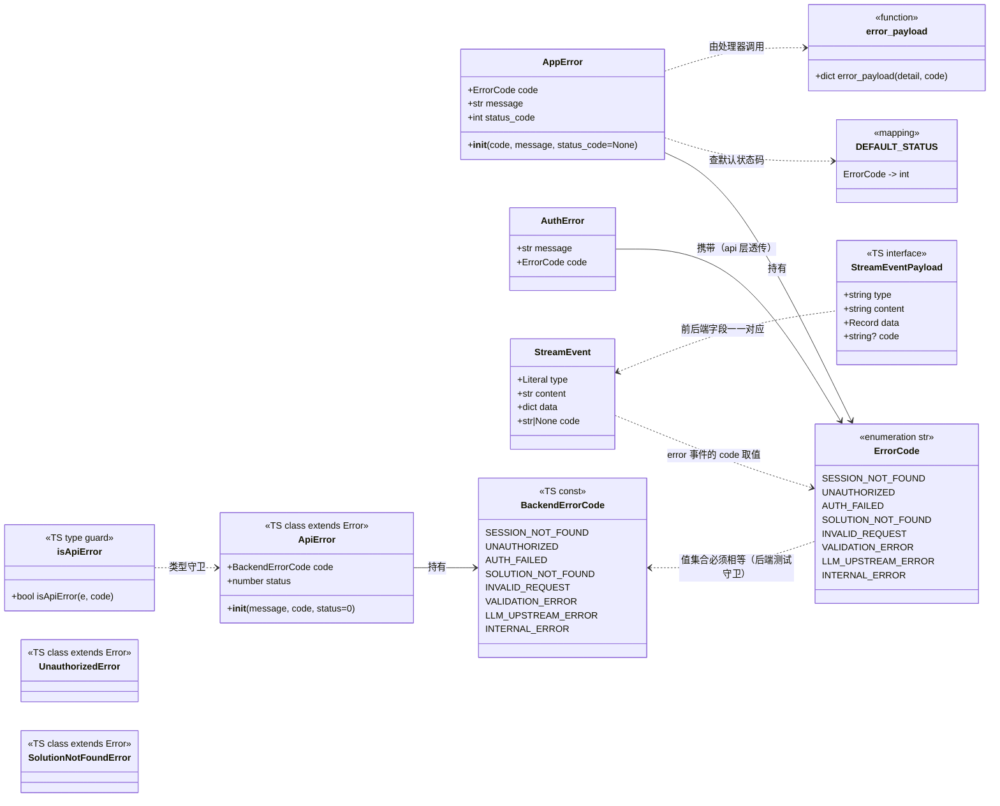
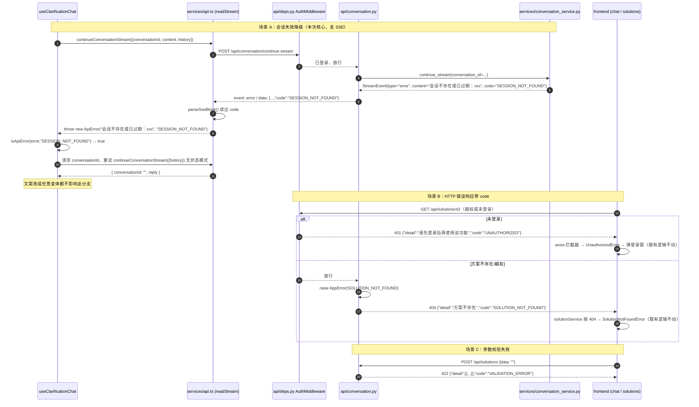
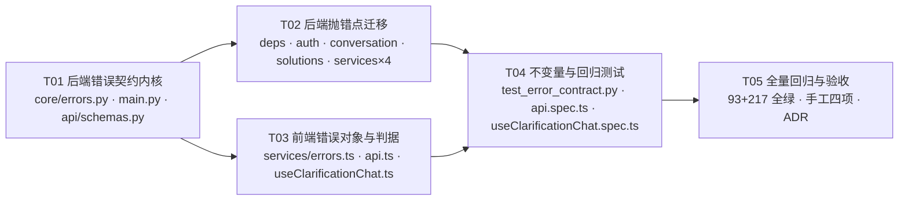

# R0-T5 错误契约机器码化 · 增量设计与任务分解

> **归档留档（已完工，不代表当前状态）**
> 本文是 2026-10-14 施工时的增量设计与任务分解，是一次性施工单据，不是常青文档。
> 结论已压缩为 [`../ADR.md` 的 ADR-012](../ADR.md)；**当前实现以 `../ARCHITECTURE.md` 为准**。
> 保留它是为了回溯「当时为什么这么拆任务」，不用于了解现状。
>
> 适用范围：既有项目上的**增量改造**（不是从零开始）。品牌 PRDwright，根目录仍为 `HarnessPRD`。
> 目标：把「错误判据靠中文串匹配」这个活 bug，换成机器可读的 `code`，并配不变量测试防回退。

---

## 0. 现状复核结论（实地读码，含对任务书的更正）

| # | 结论 | 证据 |
|---|---|---|
| 1 | 前端唯一硬判据确实是中文串匹配 | `frontend/src/composables/useClarificationChat.ts:128`<br>`if (!conversationId.value \|\| !message.includes('会话不存在')) throw error` |
| 2 | **更正**：该串不是来自 `HTTPException`，而是来自 **SSE 流式 `error` 事件** | 后端 `services/conversation_service.py:487-491` 产出 `StreamEvent(type="error", content=f"会话不存在或已过期：{conversation_id}")`；<br>前端 `services/api.ts:329-331` 收到 `error` 事件后 `failure = event.content`，`readStream` 末尾 `throw new Error(failure)`（HTTP 状态码是 **200**）<br>⇒ 只给 HTTP 响应加 `code` **解决不了这条链路**，必须同时给 SSE `error` 事件加 `code` |
| 3 | 后端确无任何机器可读错误码 | 全仓库 grep `error_code` / `ErrorCode` 零命中 |
| 4 | 后端确无异常处理器 | `main.py` 无 `@app.exception_handler`，当前错误响应来自 FastAPI 默认处理器 + 中间件裸写 JSON |
| 5 | 错误响应有 **4 个来源**，改造必须全覆盖 | ① `HTTPException`（默认处理器 → `{"detail": ...}`）<br>② `RequestValidationError`（422 → `{"detail": [...]}`，**detail 是列表**）<br>③ `AuthMiddleware._send_unauthorized`（`deps.py:113` 裸写 ASGI JSON）<br>④ SSE `error` 事件（流内，非 HTTP 错误） |
| 6 | 已做对、本次不动 | 401 → `UnauthorizedError`（`api.ts`，基于状态码）<br>404 → `SolutionNotFoundError`（`solutionService.ts`，基于状态码） |
| 7 | 已有可复用的「扫前端源码」不变量测试范式 | `backend/tests/test_conversation_prompt.py::test_frontend_holds_no_prompt_text`（扫 `frontend/src`，跳过 `__tests__`） |
| 8 | services 层已经 import `api.schemas` | `conversation_service.py:24`、`document_service.py:48` 都 `from backend.api.schemas import StreamEvent`<br>⇒ 在 `api/schemas.py` 的 `StreamEvent` 上加 `code` 字段不违反现有依赖方向；但**错误码枚举必须放 `core/`**，否则 services 反向依赖 api 之外的东西会变差 |
| 9 | `instanceof` 有个真实陷阱 | `frontend/src/__tests__/AppV2.spec.ts:19` 用 `vi.mock('../services/api', () => ({...}))` **整体替换** api 模块。若 `ApiError` 定义在 `api.ts` 里，mock 后 `instanceof ApiError` 会抛 `TypeError`。<br>⇒ `ApiError` 必须放在**独立模块**，不被 mock 波 |

---

## Part A · 增量设计

### 1. 实施思路（Implementation Approach）

**核心难点**：一处耦合在 **SSE 流内**（HTTP 200），其余耦合在 **HTTP 错误响应**里；而 `detail` 字段的语义必须保持不变（现有 93 个后端测试 + 前端 `readDetail()` / `backendMessage()` 都依赖它）。

**因此策略是「加字段 + 加异常处理器」，不是「换响应结构」：**

1. **响应体**：`{"detail": "<人类可读中文，语义不变>", "code": "<机器码>"}`。
   `HTTPException(detail={"detail":..., "code":...})` 会被 FastAPI 渲染成 `{"detail": {"detail":..., "code":...}}` 的**嵌套结构**，所以不能靠塞 dict 解决——必须注册**自定义异常处理器**，这是唯一能「一处保证所有错误响应都带 code」的做法。
2. **SSE**：给 `StreamEvent` 加一个可选 `code` 字段，`error` 事件带上它；前端 `readStream` 抛出携带 `code` 的 `ApiError`。
3. **防漂移**：后端 `core/errors.py` 是单一真源；前端 `services/errors.ts` 是单一真源；由**后端测试扫描前端源码**断言两个集合相等（复用第 7 条既有范式）。
4. **防回退**：① 后端测试断言每个 4xx/5xx 响应体含合法 `code`；② 后端测试扫描 `api/*.py` 断言 `HTTPException` 归零；③ 后端测试扫描前端源码断言不再有中文串判据。

**架构模式**：沿用现有分层——`api/` 解析/校验/封装，`services/` 业务，`core/` 跨层契约与基础设施。不引入新框架，不新增第三方依赖。

### 2. 文件清单（File List）

| 文件 | 动作 | 说明 |
|---|---|---|
| `backend/src/backend/core/errors.py` | **新建** | `ErrorCode` 枚举、`AppError` 异常、状态码默认映射、响应体构造函数 |
| `backend/src/backend/main.py` | 改 | 注册 `AppError` 与 `RequestValidationError` 两个异常处理器 |
| `backend/src/backend/api/schemas.py` | 改 | `StreamEvent` 增加 `code` 字段 |
| `backend/src/backend/api/deps.py` | 改 | `_send_unauthorized` 裸写 JSON 加 `code`；`get_current_user` / `acting_user` 改抛 `AppError` |
| `backend/src/backend/api/auth.py` | 改 | register / login / me 三处改抛 `AppError` |
| `backend/src/backend/api/conversation.py` | 改 | 4 处 `HTTPException` → `AppError`；SSE 兜底 `error` 事件带 `code` |
| `backend/src/backend/api/solutions.py` | 改 | 3 处 404 → `AppError(SOLUTION_NOT_FOUND)` |
| `backend/src/backend/services/auth_service.py` | 改（小） | `AuthError` 增加 `code` 字段，供 api 层直接透传（避免 api 层再维护映射表） |
| `backend/src/backend/services/conversation_service.py` | 改 | 「会话不存在」与「生成失败」两类 `error` 事件带 `code` |
| `backend/src/backend/services/document_service.py` | 改 | 「生成失败」`error` 事件带 `code` |
| `backend/src/backend/services/prd_section_writer.py` | 改 | `error` 事件带 `code` |
| `backend/tests/test_error_contract.py` | **新建** | 不变量 + 契约测试（含扫前端源码） |
| `frontend/src/services/errors.ts` | **新建** | `BackendErrorCode` 常量与类型、`ApiError` 类、`isApiError` 类型守卫 |
| `frontend/src/services/api.ts` | 改 | `readStream` 解析 SSE `error` 事件的 `code`，抛 `ApiError` |
| `frontend/src/composables/useClarificationChat.ts` | 改 | 判据由 `message.includes('会话不存在')` 换成 `isApiError(error, 'SESSION_NOT_FOUND')` |
| `frontend/src/__tests__/api.spec.ts` | 改 | 追加 SSE error → `ApiError.code` 的用例 |
| `frontend/src/__tests__/useClarificationChat.spec.ts` | **新建** | 降级重试用例（直接用**任意文案**构造错误，证明与文案解耦） |
| `docs/architecture/v2/ADR.md` | 改（T05 收尾） | 记一条 ADR：错误契约以 `code` 为唯一判据 |

### 3. 数据结构与接口（Data Structures and Interfaces）



### 4. 错误码清单（8 个，含触发场景）

| # | code | 载体 | HTTP/SSE | 触发场景 | 现有来源（文件:行） | 谁消费 |
|---|---|---|---|---|---|---|
| 1 | `SESSION_NOT_FOUND` | **SSE `error` 事件** | SSE（HTTP 200 流内） | `continue-stream` 传入的 `conversation_id` 在服务内存里已不存在（服务重启 / 多实例） | `services/conversation_service.py:487` | ★ **前端 `useClarificationChat` 据此清 ID 并退无状态模式重试**——本次核心 |
| 2 | `UNAUTHORIZED` | HTTP | 401 | 未登录或会话过期（不区分两者） | `api/deps.py:113`（裸写）、`api/deps.py:143`、`api/deps.py:167`、`api/auth.py:99`（`/me`） | 前端 `UnauthorizedError`（已有，基于状态码；加码后双保险） |
| 3 | `AUTH_FAILED` | HTTP | 400（注册）/ 401（登录） | `AuthError` 全部业务分支：用户名长度越界、密码过短、未填邀请码、用户名已注册、邀请码无效或已用完、注册失败、用户名或密码错误、账号已停用 | `api/auth.py:53`、`api/auth.py:70` | 登录 / 注册表单（与 `UNAUTHORIZED` 区分：前者是「你填错了」，后者是「你没登录」） |
| 4 | `SOLUTION_NOT_FOUND` | HTTP | 404 | 方案不存在 **或** 存在但不属于当前用户（后端刻意不可区分） | `api/solutions.py:70 / 94 / 113` | 前端 `SolutionNotFoundError` |
| 5 | `INVALID_REQUEST` | HTTP | 400 | 业务入参不满足：`summary` 与 `requirements` 都为空 | `api/conversation.py:268` | 通用 |
| 6 | `VALIDATION_ERROR` | HTTP | 422 | Pydantic 请求体校验失败（`detail` **仍为列表**，语义不变） | FastAPI 自动 | 通用 |
| 7 | `LLM_UPSTREAM_ERROR` | HTTP / SSE | 502 / SSE `error` | 模型侧失败：需求摘要回填失败（502）、流式生成失败 | `api/conversation.py:135`、`services/conversation_service.py:393`、`services/document_service.py:657`、`services/prd_section_writer.py:776` | 前端未来可提示「模型侧异常，可重试」（本次只留码，不改 UI） |
| 8 | `INTERNAL_ERROR` | HTTP / SSE | 500 / SSE `error` | 服务端内部错误：问卷配置文件缺失、问卷配置非法 JSON、接口规范检索失败、SSE 生成器兜底捕获 | `api/conversation.py:89 / 97 / 164`、`api/conversation.py:72` | 通用兜底 |

> **为什么是 8 个**：按「现有所有抛错点归并」得出，不预留空码。新增码必须同时改后端枚举与前端常量（后端测试会自动校验两边集合相等）。
> **已知边界**：FastAPI 框架自身产生的 404（路由不存在）/ 405 不在此列（未注册兜底处理器），见 §待明确 Q2。

### 5. 响应体与 SSE 事件结构

**HTTP 错误响应**（`detail` 语义与取值完全不变，仅并列新增 `code`）：

```jsonc
// 4xx/5xx（除 422）
{ "detail": "会话不存在或已过期：conv-1", "code": "SESSION_NOT_FOUND" }
{ "detail": "方案不存在",                 "code": "SOLUTION_NOT_FOUND" }
{ "detail": "请先登录后再使用该功能",      "code": "UNAUTHORIZED" }

// 422（detail 保持 FastAPI 的列表结构，兼容前端已有的数组特判）
{ "detail": [{"loc": [...], "msg": "...", "type": "..."}], "code": "VALIDATION_ERROR" }
```

**SSE `error` 事件**（新增顶层 `code` 字段；`content` 仍是人类可读中文）：

```
event: error
data: {"type":"error","content":"会话不存在或已过期：conv-1","data":{"conversation_id":"conv-1"},"code":"SESSION_NOT_FOUND"}

```

### 6. 程序调用流（Program Call Flow）



### 7. Anything UNCLEAR（待明确事项）

见 Part B §待明确。

---

## Part B · 任务分解

### 8. Required Packages

**无新增第三方依赖。**

```
# 后端：全部使用现有依赖（fastapi / starlette / pydantic）
# 前端：全部使用现有依赖（vue / axios / vitest）
```

### 9. 任务列表（按依赖顺序，共 5 个）

#### T01 · 后端错误契约内核与全局处理器（P0，无依赖）

| 项 | 内容 |
|---|---|
| 文件 | `backend/src/backend/core/errors.py`（新建）、`backend/src/backend/main.py`（改）、`backend/src/backend/api/schemas.py`（改） |
| 改什么 | ① `core/errors.py`：`ErrorCode(str, Enum)` 8 个成员；`DEFAULT_STATUS: dict[ErrorCode, int]`（`SESSION_NOT_FOUND` 无 HTTP 语义可不入表或记 200；`UNAUTHORIZED`/`AUTH_FAILED`→401；`SOLUTION_NOT_FOUND`→404；`INVALID_REQUEST`→400；`VALIDATION_ERROR`→422；`LLM_UPSTREAM_ERROR`→502；`INTERNAL_ERROR`→500）；`class AppError(Exception)` 含 `code / message / status_code`，`status_code` 缺省时查 `DEFAULT_STATUS`；`error_payload(detail, code) -> dict` 返回 `{"detail": detail, "code": code}`<br>② `main.py`：注册 `@app.exception_handler(AppError)`（渲染 `{"detail": exc.message, "code": exc.code.value}`）与 `@app.exception_handler(RequestValidationError)`（渲染 `{"detail": exc.errors(), "code": "VALIDATION_ERROR"}`，status 422）；注册位置在路由注册之前<br>③ `api/schemas.py`：`StreamEvent` 增加 `code: str \| None = Field(default=None, description="机器可读错误码；仅 error 事件携带，取值见 core/errors.py 的 ErrorCode")` |
| 验收 | `uv run pytest` 全绿（此时尚未改调用点，不应有行为变化） |
| 依赖 | — |

#### T02 · 后端抛错点迁移（P0，依赖 T01）

| 项 | 内容 |
|---|---|
| 文件 | `api/deps.py`、`api/auth.py`、`api/conversation.py`、`api/solutions.py`、`services/auth_service.py`、`services/conversation_service.py`、`services/document_service.py`、`services/prd_section_writer.py` |
| 改什么 | ① `services/auth_service.py`：`AuthError` 增加 `code` 属性（注册类分支 `AuthError(msg, ErrorCode.AUTH_FAILED)`；登录类分支同为 `AUTH_FAILED`）<br>② `api/auth.py`：三处 `HTTPException` → `raise AppError(code=exc.code, message=exc.message)`（register/login）与 `AppError(UNAUTHORIZED, "当前未登录")`（/me）<br>③ `api/deps.py`：`_send_unauthorized` 的裸写 JSON 改为 `{"detail": _UNAUTHORIZED_DETAIL, "code": "UNAUTHORIZED"}`；`get_current_user` / `acting_user` 改抛 `AppError(UNAUTHORIZED, _UNAUTHORIZED_DETAIL)`<br>④ `api/solutions.py`：3 处 404 → `AppError(SOLUTION_NOT_FOUND, _NOT_FOUND_DETAIL)`<br>⑤ `api/conversation.py`：`.89/.97` → `INTERNAL_ERROR`；`.135` → `LLM_UPSTREAM_ERROR`；`.164` → `INTERNAL_ERROR`；`.268` → `INVALID_REQUEST`；`.72` SSE 兜底 `error` 事件加 `code="INTERNAL_ERROR"`<br>⑥ `services/conversation_service.py:487` 加 `code="SESSION_NOT_FOUND"`；`:393` 加 `code="LLM_UPSTREAM_ERROR"`<br>⑦ `services/document_service.py:657`、`services/prd_section_writer.py:776` 加 `code="LLM_UPSTREAM_ERROR"`<br>⑧ 全部改造完成后，`api/` 下 `HTTPException` 引用应归零（由 T04 的不变量测试断言） |
| 验收 | `uv run pytest` 全绿；既有断言 `response.json()["detail"] == "方案不存在"` / `"请先登录后再使用该功能"` 仍成立（`detail` 一字未改） |
| 依赖 | T01 |

#### T03 · 前端错误对象与判据改造（P0，依赖 T01 的码值定义；可与 T02 并行）

| 项 | 内容 |
|---|---|
| 文件 | `frontend/src/services/errors.ts`（新建）、`frontend/src/services/api.ts`（改）、`frontend/src/composables/useClarificationChat.ts`（改） |
| 改什么 | ① `services/errors.ts`：导出 `BACKEND_ERROR_CODES`（8 个 `as const`）、`BackendErrorCode` 类型、`class ApiError extends Error { code; status }`、`function isApiError(e: unknown, code: BackendErrorCode): boolean`。**必须独立文件**：`AppV2.spec.ts` 会 `vi.mock('@/services/api')` 整体替换模块，放里面会让 `instanceof` 失效<br>② `api.ts`：`StreamEventPayload` 增加 `code?: string \| null`；`parseSseBlock` 解析出 `code`；`readStream` 的 `error` 分支改为记 `{ message, code }`，末尾 `throw new ApiError(message, normalizeCode(code))`（`code` 缺失/未知时降级为 `INTERNAL_ERROR`）<br>③ `useClarificationChat.ts:128` 判据改为 `if (!conversationId.value \|\| !isApiError(error, 'SESSION_NOT_FOUND')) throw error`；同步把注释里「收到『会话不存在』时」改成「收到 `SESSION_NOT_FOUND` 时」 |
| 验收 | `npm run test:unit -- --run` 与 `npm run build` 全绿 |
| 依赖 | T01（码值需与后端一致） |

#### T04 · 不变量与回归测试（P0，依赖 T02 + T03）

| 项 | 内容 |
|---|---|
| 文件 | `backend/tests/test_error_contract.py`（新建）、`frontend/src/__tests__/api.spec.ts`（追加）、`frontend/src/__tests__/useClarificationChat.spec.ts`（新建） |
| 改什么 | **后端 `test_error_contract.py`**（复用 `test_conversation_prompt.py` 的「扫前端源码」范式，`_FRONTEND_SRC = parents[2]/"frontend"/"src"`，前端不存在时 `pytest.skip`）：<br>· `test_every_error_response_carries_code`：参数化覆盖 401（未登录业务接口 / `/me`）、400（注册失败）、401（登录失败）、404（方案不存在/越权）、400（summary 与 requirements 皆空）、422（空 data），断言 `status>=400`、`body["code"]` 存在且属于 `ErrorCode` 取值集合、`body["detail"]` 非空<br>· `test_frontend_error_codes_match_backend`：正则解析 `frontend/src/services/errors.ts` 中的码值集合，断言与 `{c.value for c in ErrorCode}` **相等**（防两边漂移）<br>· `test_frontend_makes_no_chinese_string_judgement`：扫描 `frontend/src` 下非 `__tests__` 的 `.ts/.vue`，禁止「对含中文的字符串字面量做包含/相等判断」（`includes(` / `indexOf(` / `startsWith(` / `endsWith(` / `match(` / `===` / `!==` 后接含中文的字符串字面量）。已核查：现有源码中除 `useClarificationChat.ts:128` 外**零误报**<br>· `test_api_layer_raises_no_bare_http_exception`：扫描 `backend/src/backend/api/*.py`，断言不再出现 `HTTPException`（防新代码回退）<br>**前端**：<br>· `api.spec.ts` 追加：SSE `error` 事件带 `code` → 抛出的 `ApiError.code` 正确；不带 `code` → 降级为 `INTERNAL_ERROR`；`code` 未知 → 降级为 `INTERNAL_ERROR`<br>· `useClarificationChat.spec.ts` 新建：mock `continueConversationStream` 首次以 `new ApiError('随便改成什么文案', 'SESSION_NOT_FOUND')` 拒绝 → 断言清空 `conversationId` 后以无状态模式重试一次；以 `LLM_UPSTREAM_ERROR` 拒绝 → 断言**不**重试并向上抛 |
| 验收 | 后端 93+ 例、前端 217+ 例全绿 |
| 依赖 | T02、T03 |

#### T05 · 全量回归与验收（P1，依赖 T04）

| 项 | 内容 |
|---|---|
| 文件 | `docs/architecture/v2/ADR.md`（追加一条 ADR）；不改业务代码（手工验收的临时改动必须还原） |
| 改什么 | ① 全量跑：`cd backend && uv run pytest`；`cd frontend && npm run test:unit -- --run && npm run build`<br>② 手工验收四项：a) 前端源码 grep 不到 `includes('中文')` 这类判据；b) 任一 4xx/5xx 响应体含 `code`；c) 310 用例全绿；d) **临时**把后端「会话不存在或已过期」改成任意变体（如「该会话已失效：」），跑前端用例 + 手点一次续接对话，确认降级仍生效，**然后改回**<br>③ ADR 记录：错误契约以 `code` 为唯一机器判据，`detail` 仅供展示且可随时改写 |
| 验收 | 四项全过；`git status` 干净（除本次设计改动外无残留） |
| 依赖 | T04 |

### 10. Shared Knowledge（跨任务共享约定）

```
1. 响应体：{"detail": <原样不变>, "code": "<UPPER_SNAKE_CASE>"}。detail 是人类可读中文，可随时改写；
   code 是唯一机器判据。禁止用 detail 做分支判断。
2. 码值命名：UPPER_SNAKE_CASE、英文、名词或状态短语（SESSION_NOT_FOUND，不是 session-not-found / 404）。
3. 后端单一真源：backend/src/backend/core/errors.py :: ErrorCode。
   前端单一真源：frontend/src/services/errors.ts :: BACKEND_ERROR_CODES。
   两边相等由后端测试 test_frontend_error_codes_match_backend 守着——新增码只改一边会红。
4. 分层：core/ 放跨层契约（services 与 api 都能 import，不产生反向依赖）；
   api/ 只做解析/校验/封装；services/ 抛域错误（AuthError 带 code），由 api 层透传，不在 api 层写映射表。
5. SSE：error 事件的 code 走 StreamEvent 的顶层 code 字段，不塞进 data（data 保留给事件专属载荷）。
6. 前端禁止：error.message.includes('中文') / indexOf / startsWith / === 等一切基于文案的判定，
   统一用 isApiError(error, 'XXX')。
7. ApiError 必须定义在 frontend/src/services/errors.ts（独立模块），不得放进 services/api.ts——
   AppV2.spec.ts 会整体 mock '@services/api'，放里面会让 instanceof 抛 TypeError。
8. 既有结构化处理保持不动：401 → UnauthorizedError（api.ts）、404 → SolutionNotFoundError（solutionService.ts）。
9. 注释与 docstring 一律中文，标识符一律英文。
10. 不新增第三方依赖；不做无关重构。
```

### 11. 任务依赖图（Task Dependency Graph）



### 12. 待明确事项（需拍板）

| # | 问题 | 备选 | 我的建议 |
|---|---|---|---|
| Q1 | SSE `error` 事件的 `code` 放**顶层字段**还是 `data.code`？ | A. `StreamEvent` 新增 `code` 字段（会出现在 OpenAPI 里，自解释）；B. 放进现有 `data` 字典（不动模型，但 `data` 混杂语义） | **A**。改动仅一个字段，前端 `parseSseBlock` 多读一次；可发现性明显更好 |
| Q2 | 是否注册 `StarletteHTTPException` **兜底处理器**，让框架生成的 404（路由不存在）/ 405 也带 `code`？ | A. 不加（保持 8 码，最小变更）；B. 加，需再引入第 9 个通用码 `NOT_FOUND` | **A**。本次只保证「我们自己抛的错」带码；框架级 404 无业务语义。若坚持「任何 4xx 都有 code」则选 B |
| Q3 | 422 的 `detail` 仍是**列表**（`solutionService.ts` 已特判成「提交的内容不符合要求…」），要不要顺手统一成字符串？ | A. 不动；B. 改成字符串 | **A**。`detail` 语义不变是本次向后兼容的前提，动它会波及前端既有分支 |
| Q4 | `services/auth_service.py` 的 `AuthError` 是否需要带 `code`？ | A. 带（api 层直接透传）；B. 不带（api 层按端点写死 AUTH_FAILED） | **A**。避免 api 层再维护一张「文案→码」映射表，那正是本次要消灭的东西 |
| Q5 | 现有 `UnauthorizedError`（`api.ts`）要不要改成继承 `ApiError`？ | A. 不动；B. 继承并带上 `code='UNAUTHORIZED'` | **A**。它已基于 HTTP 401 工作正常，改它属于「顺手优化」，超出最小变更 |
| Q6 | 前端是否要在 UI 上对 `LLM_UPSTREAM_ERROR` 做「模型侧异常，可重试」的差异化提示？ | A. 本次只留码，不动 UI；B. 顺手做 | **A**。UI 改动超出 R0-T5 范围，留到后续需求 |
| Q7 | 手工验收第 4 项要临时改后端文案（再改回），是否接受这个临时脏改动？ | — | 必须**改回后再提交**；建议验收动作单独立一步、不与代码改动混在同一批修改里 |

### 13. 验收标准（对齐任务书）

| # | 标准 | 由谁保证 |
|---|---|---|
| ① | 前端零中文串判据 | T03 改掉唯一一处；T04 `test_frontend_makes_no_chinese_string_judgement` 守住 |
| ② | 后端错误响应带 `code` | T01 处理器 + T02 迁移；T04 `test_every_error_response_carries_code` 守住 |
| ③ | 现有 310 用例仍全绿 | T05 全量跑（后端 93 / 前端 217） |
| ④ | 把后端「会话不存在」文案改成任意变体，前端降级仍生效 | T04 `useClarificationChat.spec.ts` 用**任意文案**构造 `ApiError` 直接证明；T05 再做一次真手工验证 |
