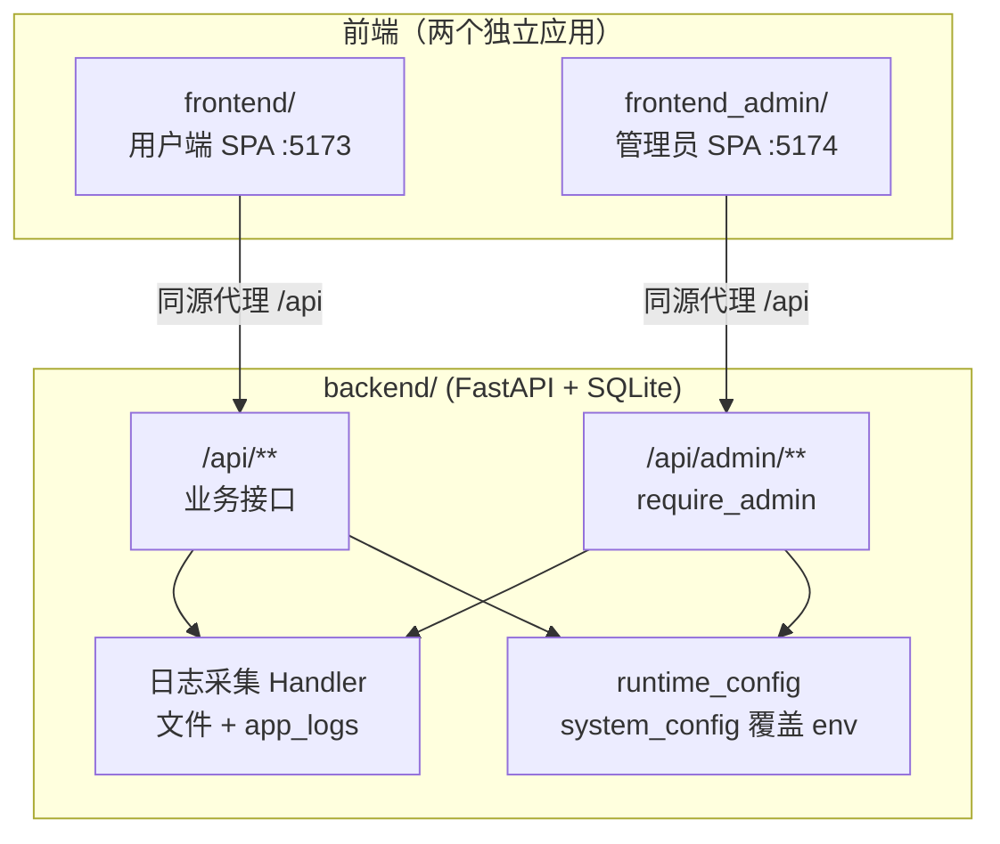

# v4 架构：平台化运营（管理员后台 + 日志可查）

> 本文**正向描述** v4 要建成什么样（目标 → 范围 → 形态 → 设计 → 契约 → 取舍），
> 不做「还缺什么」的盘点。与 `../v3/ARCHITECTURE.md` 是同一套写法。

---

## 1. 目标与范围

### 1.1 四句话目标

1. **有管理员**：后端能区分「普通用户」与「管理员」，且这个区分由服务端强制，不靠前端藏。
2. **能运营**：管理员在一个独立后台里管邀请码、管用户、看平台用量、调系统参数。
3. **日志可查**：后端日志不再只往 stdout 一丢了之，管理端能检索、过滤、看详情、实时尾随。
4. **可问责**：管理员的每一个写操作都留痕（审计）。

### 1.2 本期范围（In）

| 能力 | 说明 |
| --- | --- |
| 管理员身份 | `users.is_admin` + `require_admin` 服务端守卫 |
| 邀请码管理 | 多码并存，管理员可增、删、设上限与过期（**表已支持多码，只差接口与 UI**） |
| 用户管理 | 列表（注册时间 / Token 用量 / 任务数 / 状态）、新建、删除、启停、重置密码 |
| 平台统计 | PRD 生成总量、按用户 / 按日的用量与趋势 |
| 系统配置 | 每日生成上限、模型调用超时与重试、单用户 Token 上限、切换模型供应商 |
| **日志查看** | 采集落盘 + 落库、按级别 / 时间 / `request_id` / 关键词检索、详情、实时尾随 |
| 审计日志 | 管理员的写操作留痕（谁 / 何时 / 改了什么） |

### 1.3 本期明确不做（Out）

| 不做 | 理由 |
| --- | --- |
| 计费与支付 | 与「运营可观测」不是同一件事；Token 统计只做计量不做结算 |
| 多租户 / 团队空间 | 当前是单用户数据归属，团队化会牵动 `user_id` 的全链路语义 |
| 2FA / 管理员独立登录门户 | 本期管理员复用同一套登录 + `is_admin` 判定；独立门户属纵深防御的增强项 |
| **明文 API 密钥托管** | 库里只存环境变量名引用（ADR-042）；真要托管得先解决加密与轮换 |
| 日志全文检索（ES / FTS5） | SQLite `LIKE` + 索引在本量级够用；引入检索引擎是运维税，YAGNI |
| 管理员查看用户 PRD 正文 | 隐私与体量都不划算；管理员只管「账号与用量」，不审内容 |
| 把启动项（端口 / DB 路径 / 是否鉴权）做成运行时可改 | 会制造「改了要不要重启」的认知混乱（ADR-041） |

---

## 2. 部署形态与拓扑

根目录三个**并列**的顶层工程，共享同一个后端 API 源：

**为什么两个前端能共用登录态**：会话 Cookie 是后端设在 **API 域**上的
（`auth_cookie_name=prdwright_session`），两个前端只要请求同一个 API 源，Cookie 自动带上，
**不需要任何桥接**。代价是把管理员源加进 `cors_origins`（当前默认只有
`http://localhost:5173`），且 `allow_credentials` 已为 true。

**部署时的两个 SPA**（后端目前不托管 `dist`，因此这是新引入的事项，二选一）：

| 方案 | 做法 | 取舍 |
| --- | --- | --- |
| 反代分路径（推荐） | `/` → 用户端产物，`/admin/*` → 管理员产物，两条都配 SPA fallback | 一个域名、一套证书；但要小心 `/admin` 与用户端路由不撞 |
| 独立子域 | `admin.example.com` → 管理员产物 | 边界最干净，便于加 IP 白名单 / 仅内网；多一组 DNS 与证书 |

> 同一个后端 Serving 两个 SPA 也可以（挂两个 `StaticFiles` + 各自的 fallback），
> 但把静态托管塞进 API 进程会让「重启 API = 后台打不开」，生产环境优先走反代。

---

## 3. 后端地基（先于任何功能）

这六项不落地，后面每一块功能都会卡住。**它们是 v4.0 / T0 的全部内容。**

| # | 地基 | 落点 | 要点 |
| --- | --- | --- | --- |
| F1 | 管理员身份 | `users.is_admin` 列（**迁移 v12**）→ `User` 与 `current_user` 带出 | ⚠️ 结构变更一律**追加新版本号**，不得回改已应用的迁移步骤（按 `user_version` 跳过的步骤改了等于没改） |
| F2 | 服务端守卫 | `api/deps.py` 新增 `require_admin` 依赖 | 校验 `is_admin`，否则 403。**所有** `/api/admin/**` 强制套；前端路由守卫只是体验，不是防线 |
| F3 | 运行时配置层 | `system_config` 表 + `core/runtime_config.py` | 见第 5 节 |
| F4 | Token 用量持久化 | `generation_jobs` 加 `prompt_tokens` / `completion_tokens`（迁移 v14） | 当前用量只存在于 `run_summary` 的 JSON 里，聚合要解析文本；加两列后「每用户用量 / 平台总量」才是 SQL 能算的 |
| F5 | 审计日志 | `admin_audit_log` 表（迁移 v15） | `actor_id / action / target / before / after / request_id / ts`。管理员每一次写操作都记 |
| F6 | 跨域与来源 | `cors_origins` 增加管理员源 | 开发态加 `:5174`；部署态加管理员域名。写成逗号列表即可，不新增配置项 |

分层纪律照旧：`api/` → `services/` → `repositories/`（**只有仓储层写 SQL**）；
错误码复用 `core/errors.py` 既有体系（权限拒绝不另造状态码，与既有枚举对齐即可）。

---

## 4. 日志子系统（本次重点）

### 4.1 现状与痛点

`core/logging_setup.py` 目前**只装了一个 `StreamHandler(sys.stdout)`**：

- 每条日志已经很规整（`ts` / `level` / `logger` / `msg` / `request_id` / `extra=` 业务字段，
  `LOG_FORMAT=json` 时一行一条 JSON）——**采集端几乎不用改格式化逻辑**。
- 但**没有任何持久化**：进程一停，历史全没；管理端也就无从「查看日志」。

因此「完善的日志查看」不是加一个页面，而是补一条 **采集 → 存储 → 检索 → 呈现** 的链路。

> ⚠️ **采集必须先行（ADR-040）**：日志是「从现在开始攒」的数据。若等到 T4 做 UI 时才开采集，
> 后台上线那天看到的就是空列表。所以 **Handler 在 T0 就要挂上**，UI 放 T4。

### 4.2 采集：一个 Handler 挂进去，业务代码零改动

新增 `LogStoreHandler`（`logging.Handler` 子类），在 `configure_logging` 里与 stdout handler
并列装上。业务代码那一行 `logger.info(...)` **一行都不用改**——这与现有
`request_id` 自动注入是同一条设计纪律（加字段只改格式化器一处）。

Handler 同时做两件事（**双写**）：

| 去向 | 形式 | 作用 | 可否关闭 |
| --- | --- | --- | --- |
| **轮转文件** | `RotatingFileHandler`（如 `logs/prdwright.log`，5MB × 5 份） | 永不丢、可脱机排查、可喂给外部采集 | 否（始终开） |
| **`app_logs` 表** | 异步批量插入 | 后台能过滤 / 分页 / 排序 | 是（`log_db_enabled`） |

**为什么不是「二选一」**：纯文件 → 后台检索要现解析文本、还要处理轮转与并发读；
纯 DB → 每次 `logger.info` 都写库，日志放大 DB 写压力且丢文件这个兜底。
两者成本都很低，合起来才同时满足「不丢」与「可查」。

### 4.3 存储：`app_logs` 表（迁移 v13）

| 列 | 说明 |
| --- | --- |
| `id` | 自增主键 |
| `ts` | UTC ISO8601（毫秒），与格式化器一致 |
| `level` | `DEBUG/INFO/WARNING/ERROR` |
| `logger` | 来源（如 `backend.main`、`backend.services.job_service`） |
| `msg` | 消息正文 |
| `request_id` | 可为 NULL（启动日志本就不属于任何请求） |
| `user_id` | 尽力带出（上下文有就填） |
| `event` | **从 `extra.event` 提升成列**（如 `service.started`、`ask.option_without_description`），它是分类检索的主维度 |
| `extra_json` | 其余 `extra=` 业务字段原样存 JSON |
| `exc` | traceback（仅 `exc_info` 存在时） |

索引：`(ts)`、`(level, ts)`、`(request_id)`。**不建全文索引**（见 1.3）。

### 4.4 保留策略

日志会无限增长，必须可裁剪：`log_retention_days`（默认 7 天）与 `log_max_rows`
（默认 5 万条，超过按时间淘汰）。裁剪在**启动时执行一次 + 写入时懒触发**（不引入定时任务进程）。

### 4.5 检索与呈现（T4）

`GET /api/admin/logs` 支持：时间范围、级别（多选）、`logger`、`event`、`request_id`、
关键词（`msg` 的 `LIKE`）、分页（游标或 offset）、排序（时间倒序）。

UI 四件事：

1. **过滤条 + 表格**：级别用颜色区分，默认最近 24h、`WARNING` 及以上优先。
2. **详情展开**：看 `extra_json` 全字段与 `exc`（traceback 保留换行）。
3. **`request_id` 反查**：这是排障主路径——用户回执上那个号粘进来，一次请求的全部日志按时间排好。
   （`request_id` 已在 R1 贯通响应头与回执，这里把它接到日志上，链路才算闭环。）
4. **实时尾随**：`GET /api/admin/logs/stream`（SSE，复用 `api/sse.py` 既有模式），
   带心跳保活、可按级别过滤、可暂停/继续、自动降级为轮询。

### 4.6 三条硬约束

- **绝不阻塞主流程**：入库走异步批量（内存队列 + 定时/阈值 flush）；队列满或写失败
  **丢弃并降级**（记一条 WARNING），绝不能因为日志写不动而拖垮生成链路。
- **必须 `require_admin`**：日志里可能有用户名、方案 id、请求号，属高权限数据。
- **写入要克制**：`log_db_min_level` 默认 `INFO`；`DEBUG` 级别的库内写入默认不建议开
  （调试期临时开，量级不可控）。
- **停止信号要能被快速响应**：后台线程等队列时必须把等待切成小段（≤50ms），
  不能一次等到 `interval` 结束——否则关服务最坏要干等一整个间隔，
  而那段时间正是「最后一批日志还没落库」的窗口（实现踩过一次，见 `_collect`）。

---

## 5. 运行时配置与模型供应商

### 5.1 为什么需要「运行时配置层」

当前所有可调项都由 `.env` 经 `get_settings()` 读成**进程内缓存单例**（`@lru_cache`）。
要「管理员在后台改参数并生效」，必须让这些值来自 DB，而不是启动快照。

做法（ADR-041）：`system_config` 表 + `core/runtime_config.py`。

- **解析顺序**：DB 覆盖值 > 环境变量 > 字段默认值。
- **只有白名单项可进 DB**。白名单之外的项永远读 env——避免把
  `db_path` / `host` / `port` / `auth_enabled` / `cors_origins` / 供应商密钥
  这类**启动项**变成「改了要重启」的认知陷阱。
- **缓存**：进程内 30 秒 TTL；管理员写入时**立即失效**并记审计。（单进程部署足够；
  将来多进程靠 TTL 兜底，不引入消息广播。）
- **写入校验**：类型与范围在 `runtime_config` 里集中校验（与 env 的 `Field(ge=, le=)` 同一套约束），
  非法值 400，不静默截断。

### 5.2 白名单（运营可调）

| 分组 | 可调项 |
| --- | --- |
| 配额 | 单用户每日 PRD 上限、单用户并发生成数、全局每日上限、单用户 Token 上限、全局告警阈值、超限行为（拦截 / 只告警） |
| 模型与调用 | **激活供应商**、默认模型、单次超时、总超时、重试次数与间隔、预算上限与分阶段覆盖、并发度、单章重试 / 改写次数、是否启用审核、各类 `max_tokens` |
| 安全 | 会话有效期、是否开放注册、登录失败次数上限与锁定时长 |
| 日志 | 日志级别、日志格式、**日志保留天数 / 最大条数 / 是否落库 / 落库最低级别** |
| 运维 | 维护模式（临时停新生成、保留只读） |

> 这些字段**绝大多数在 `core/config.py` 里已经存在**（`llm_timeout` / `llm_max_retries` /
> `prd_pipeline_concurrency` / `default_llm_provider` …），把它们从「只读 env」改成
> 「优先读 runtime_config」即可，UI 是纯增量。这是整个 v4 里**性价比最高**的一块。

### 5.3 模型供应商：`model_providers` 表（迁移 v16）

| 列 | 说明 |
| --- | --- |
| `id` / `name` | 标识与展示名 |
| `provider_type` | `anthropic` / `openai` / `ark` / `custom` |
| `api_key_env_var` | **只存环境变量名**（如 `ARK_API_KEY`），不落明文（ADR-042） |
| `base_url` / `default_model` | 端点与默认型号 |
| `priority` / `created_at` / `updated_at` | 排序与审计信息 |

**激活哪一个**：单一真源放在 `system_config.active_provider_id`，**不靠表里加 `is_active` 列**
——后者会出现「两行都是 1」的不一致态，而前者天然只有一个值。
`services/llm_factory.py` 改读「激活供应商行」（经 runtime_config 缓存），切换后立即失效缓存。

**密钥取舍**：库里存变量名引用，密钥仍由 `require_api_key()` 从环境取。
代价是新增供应商仍需碰 `.env`；收益是**把明文凭据的泄漏面挡在数据库之外**。
（真要做密钥托管，得先解决加密存储与轮换，本期不做。）

---

## 6. frontend_admin 设计

### 6.1 形态

根目录新建 `frontend_admin/`：独立 `package.json`、独立 Vite + Vue3 + Tailwind
（与用户端同栈，视觉语言一致）。**不引入 monorepo**（已否决，见 ADR-039）。

- 开发端口 `5174`，`/api` 代理到 `8000`。
- 构建产物独立；部署走第 2 节的两种方案之一。

### 6.2 页面

| 路由 | 页面 | 依赖 |
| --- | --- | --- |
| `/login` | 管理员登录（复用 `/api/auth/login`） | F1 |
| `/dashboard` | 概览：平台总量、健康、近期失败 | F4 |
| `/users` | 用户管理（列表 / 新建 / 启停 / 删号 / 重置密码 / 用量） | F1、F4 |
| `/invites` | 邀请码（列表 / 新建 / 删除 / 上限与过期 / 已用次数） | — |
| `/stats` | 用量统计（按用户 / 按日趋势 / Token） | F4 |
| `/config` | 系统配置（配额 / 模型与超时 / 供应商三个分组） | F3 |
| `/logs` | **日志查看**（检索 / 过滤 / 详情 / 实时尾随） | 第 4 节 |
| `/audit` | 审计日志 | F5 |

### 6.3 鉴权流程

1. 登录 → 后端下发既有会话 Cookie。
2. 进任意页前 `GET /api/admin/me` 取 `is_admin`。
3. 非管理员：停在「无权限」页（**不暴露管理员功能入口**）；未登录：跳 `/login`。
4. axios 拦截器统一处理 401（跳登录）与 403（无权限）。
5. **后端每一条 `/api/admin/**` 都过 `require_admin`**——前端守卫只负责让用户少点一次。

### 6.4 与用户端的代码关系

两个应用**物理隔离**，管理员端**不得 import** `frontend/` 的任何模块。代价是管理员端要自带
一份薄 `services/api.ts`（只含它需要的管理端点）+ 登录态 composable + 少量类型。
这是**刻意接受的重复**：它换来完全独立的构建、部署与依赖树，且重复面只有「HTTP 封装」
这一层，业务组件（PRD 看板、澄清卡等）两边本就不通用。

---

## 7. 契约（API 草案）

统一前缀 `/api/admin/**`，全部 `require_admin`。

| 方法 | 路径 | 说明 |
| --- | --- | --- |
| GET | `/me` | 当前管理员身份 |
| GET / POST / DELETE | `/users`、`/users/{id}` | 列表（含用量聚合）/ 新建 / 删除 |
| POST | `/users/{id}/disable`、`/enable`、`/reset-password` | 启停与改密 |
| GET / POST / DELETE | `/invites`、`/invites/{code}` | 邀请码 CRUD |
| GET | `/stats/overview`、`/stats/users`、`/stats/daily` | 平台与用户统计 |
| GET / PUT | `/config` | 读 / 改白名单内的运行时配置 |
| GET / POST / PUT / DELETE | `/providers`、`/providers/{id}` | 供应商 CRUD |
| POST | `/providers/{id}/activate` | 切换激活供应商 |
| GET | `/logs` | 日志检索（分页 + 过滤） |
| GET | `/logs/stream` | SSE 实时尾随 |
| GET | `/audit` | 审计日志 |

契约纪律：`api/schemas.py` 上加 Pydantic 模型（**不裸 dict**）；错误码复用
`core/errors.py` 既有体系；分页参数与既有风格保持一致。

---

## 8. 取舍与风险

| 议题 | 取 | 舍 | 记录 |
| --- | --- | --- | --- |
| 后台形态 | 独立应用：硬隔离、独立构建部署 | 多一套工具链与少量 HTTP 封装重复；**git 冲突并不会因此减少**（同仓库同历史） | ADR-039 |
| 日志存储 | 文件 + DB 双写：不丢且可查 | 多一份存储与保留策略要维护 | ADR-040 |
| 配置生效 | DB 覆盖 env（白名单） | 白名单外的项仍需改 env 重启；多进程下靠 TTL 而非广播 | ADR-041 |
| 供应商密钥 | env 引用，不落明文 | 新增供应商仍需碰 `.env` | ADR-042 |
| 管理员角色 | 单一 `is_admin` | 不做分级 RBAC（YAGNI）；审计表已留 `actor/action`，将来分级只加列 | — |

**风险登记**

| 风险 | 说明 | 缓解 |
| --- | --- | --- |
| 运行时配置改造面变宽 | 让 `llm_factory` / `job_service` 改读 `runtime_config` 会碰生成主链路 | 只改白名单项的读取点；每改一处配一条「改前值 == 改后值」的回归用例（默认走 env） |
| 日志写放大 | 高并发生成时日志入库可能成为瓶颈 | 异步批量 + 队列上限 + 失败降级；`log_db_min_level` 默认 INFO |
| 迁移撞车 | v4 要加 5 张/列级变更（v12–v16） | 一律**追加新版本号**；迁移用例断言 `run_migrations() == len(MIGRATIONS)`，不写死数字 |
| CORS 漏配 | 管理员源没进白名单 → 登录请求被拦且报错不直观 | F6 与部署清单同步；`/health` 保持不变以便快速自检 |

---

## 9. 与 v3 的关系

- v4 **不改** v3 定型的生成链路、文档所有权与版本链（ADR-021 ~ 038 继续有效）。
- 对用户端 `frontend/` 的侵入只有两处：后端 `cors_origins` 多一个源、`users` 多一列。
- 管理员后台**不得反向依赖**用户端的业务组件与状态（见 6.4）。
- 所有 schema 变更走 `core/migrations.py` 的幂等清单，**追加新版本号**，
  不回改已应用步骤（这是本项目踩过并付出过代价的约定）。
